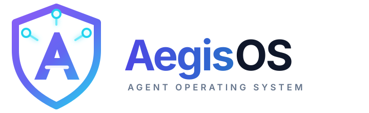
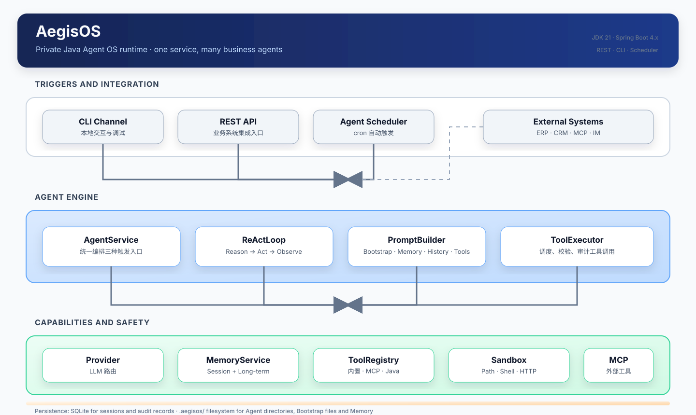

# AegisOS

<p align="center">
  
</p>

> Java 原生的企业级 Agent OS 运行时底座：私有部署、统一接入、可审计、可扩展。

[](docs/IndustryResearch.md)
[](docs/TechnicalSolution.md)
[](docs/TechnicalSolution.md)
[](#许可证)

AegisOS 运行在企业自己的服务器、虚拟机或 Kubernetes 环境中，为多个业务 Agent 统一提供大模型调用、ReAct 推理、记忆、工具、渠道、定时任务、审计和 REST 接入能力。业务方通过 Agent 目录描述“做什么”和“怎么运行”，不需要为每个 Agent 重复编写后端服务。

> 当前仓库处于设计准备阶段，尚未建立 Java 源码、Maven 工程、测试工程或可运行的构建命令。本文档中的命令属于规划接口，正式实现后需要以仓内配置和验证结果为准。

## 为什么做 AegisOS

企业真正需要的是一个私有、可控、可审计的 Agent 统一底座：数据留在自己的基础设施，模型和工具可以替换，Agent 能接入现有 ERP、CRM、CMDB、知识库和监控系统。AegisOS 补齐 Java/Spring 生态在 Agent OS 这一层的缺口，复用企业已经熟悉的 Spring Boot、JVM 和运维体系。

AegisOS 专注运行时，不承担可视化 Workflow 编排。Dify、Coze 等平台可以作为上层客户端，通过 REST API 调用 AegisOS。

## 核心能力

| 能力 | 说明 |
| --- | --- |
| Provider | 通过统一抽象接入 DeepSeek、通义、Kimi、OpenAI 等模型，Agent 不绑定具体厂商。 |
| ReAct Loop | 自主驱动“思考 → 调用工具 → 观察结果 → 继续推理”，直到返回最终结果。 |
| Memory | 保存会话上下文和长期记忆，默认使用 `.aegisos/memory/MEMORY.md`，核心阶段同时支持 SQLite 和 Mem0 后端。 |
| Tool | 提供 9 个内置工具（文件、Shell、HTTP、Memory、通知），并支持 MCP 和 Java `@Tool` 扩展。 |
| Web Service | 通过 REST API 提供 Session、Agent 调用、Profile、Memory、Tool 和系统状态能力。 |

## 架构



所有入口都汇入同一个 `AgentService`，因此 CLI、REST API 和定时任务共享相同的 ReAct、Tool 执行、Memory 和审计链路。

```text
CLI / REST API / Scheduler
            ↓
       AgentService
            ↓
        ReActLoop
            ↓
 PromptBuilder → Provider → LLM
            ↓
       ToolExecutor
            ↓
  Sandbox → Tool / MCP / Java Tool
            ↓
 Session / Memory / Audit Storage
```

关键技术边界：

- ReAct loop 由 AegisOS 自己实现，不使用 Spring AI 的 Agent 抽象。
- Spring AI 只负责 Provider、协议转换和 Tool schema 生成，禁止启用自动 Tool 执行。
- Provider name 到 `ChatModel` 使用显式映射，避免多 Provider 场景下的类型歧义。
- 内置 Tool、MCP Tool 和 Java Plugin Tool 统一适配为 `AegisTool`。
- Tool 执行先经过 Sandbox；核心阶段的白名单校验不等于容器级或 microVM 级隔离。
- `tool_invocations` 和 `llm_calls` 在核心阶段就写入持久化层，不能只依赖日志。

## Agent 定义

一个 Agent 对应一个目录：

```text
.aegisos/
├── agents/
│   └── <name>/
│       ├── AGENT.md       # frontmatter 是 Profile，正文是任务指令
│       ├── skills/        # 公共 Skill 的相对软连接
│       ├── scripts/       # 可选脚本
│       └── REFERENCE.md   # 可选参考资料
├── skills/                # 公共 Skill 实体库
├── memory/
│   └── MEMORY.md          # 长期记忆
├── sessions/              # Session 数据
├── logs/                  # 结构化日志
├── AGENTS.md              # 项目级 Bootstrap
├── SOUL.md                # Agent 人格 Bootstrap
└── USER.md                # 用户偏好 Bootstrap
```

`AGENT.md` 的 frontmatter 派生为 Profile，正文进入 system prompt。Skill 的元数据可以进入上下文，Skill 正文、参考资料和脚本按需读取。Agent 目录是上下文来源，不是一个可执行 Tool。

## 计划中的开发顺序

```text
US-1 Provider
    ↓
US-2 ReAct
    ↓
US-3 Memory  ─┐
              ├──→ US-5 Web Service
US-4 Tool    ─┘
```

核心阶段先交付运行时内核；多租户、SSO、RBAC、完整 Tool Policy、容器或 microVM Sandbox、向量记忆、流式响应、多渠道 IM、Web 管理台、完整审计查询、集群高可用和跨节点 Agent 协作属于后续扩展或社区共建。

## 规划中的快速开始

以下命令描述目标使用方式，当前尚未实现，不能作为现阶段的运行验证：

```bash
# 初始化工作区
aegisos init

# 创建一个 Agent
aegisos profile create hello-agent

# 配置环境变量后启动交互式对话
export DEEPSEEK_API_KEY=<your-api-key>
aegisos chat --profile hello-agent

# 启动 REST API
aegisos serve --port 8080
```

业务系统计划通过以下类型的接口接入：

```text
POST /api/v1/sessions
POST /api/v1/sessions/{id}/messages
GET  /api/v1/sessions/{id}
POST /api/v1/agents/{name}/invoke
GET  /api/v1/health
```

## 文档导航

| 文档 | 内容 |
| --- | --- |
| [行业调研](docs/IndustryResearch.md) | Agent OS 定义、行业空白、Java 生态位置和长期愿景。 |
| [需求分析](docs/DemandAnalysis.md) | 功能需求、非功能需求、核心/扩展边界和验收目标。 |
| [技术方案](docs/TechnicalSolution.md) | 架构、模块、数据、接口、Sandbox、Memory 和实施节奏。 |
| [AI 编程指南](docs/AiProgrammingGuide.md) | Spec-Kit、User Story、实施依赖和增量开发方式。 |
| [Agent 指南](AGENT.md) | 面向 AI Agent 的仓库协作约定和事实源读取方式。 |

## 当前状态与开发前置事项

设计基线已经统一：技术方案和 AI 编程指南均按 14 个 Maven 模块；场景验收为三个端到端 Demo，Web Service 独立验收；Agent 配置通过运行时监听和每轮读取热加载；长期记忆默认使用 `MEMORY.md`，并支持 SQLite/Mem0；核心阶段内置 Tool 固定为 9 个。正式实现前仍需把这些设计落到源码、测试和可验证的构建命令中。

主体开发计划使用 Spec-Kit 生成 `constitution`、`spec`、`plan` 和 `tasks`，小型增量功能使用手动提示词配合已有代码。

## 参与贡献

项目进入代码实现阶段后，建议按以下方式贡献：

1. 先阅读本 README 和 `AGENT.md`，再阅读相关需求与技术方案章节。
2. 对跨模块或核心能力改动，先补充或更新对应的设计与验收说明。
3. 保持变更范围最小，补充必要测试，并运行仓库中已验证的质量检查命令。
4. 在 Pull Request 中说明背景、行为变化、验证结果和未解决风险。

## 许可证

当前仓库尚未包含 `LICENSE` 文件。正式开源发布前需要由项目维护者确定并补充许可证。
