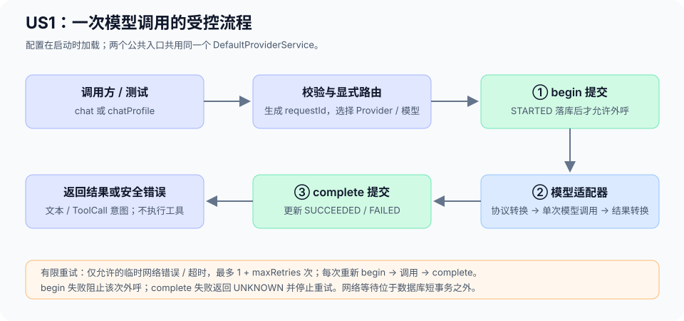

# US1 Provider 代码阅读指南

本文帮助首次阅读 AegisOS 的开发者跟通一次模型请求。适用于 `codex/us1-provider` 分支，覆盖原 US1 Provider 抽象（002）和 Provider 课程补齐（005）。

US1 负责按明确配置调用指定模型，统一处理协议转换、有限重试和持久审计。ReAct 推理循环、实际工具执行和完整会话管理属于后续能力。当前没有 Provider HTTP 调试业务接口，阅读和调试从 Java 服务及测试开始。

## 1. 先认识四个模块

工程保持九模块，本次主线集中在以下四个模块。文中源码链接均相对仓库解析，可直接在 GitHub 查看。

| 模块 | 职责 | 首次阅读时关注 |
| --- | --- | --- |
| `aegisos-core` | 公共接口、请求响应、Profile 和审计契约 | 输入与输出是什么 |
| `aegisos-provider` | 路由校验、调用编排、协议转换和重试 | 一次请求怎样完成 |
| `aegisos-storage` | SQLite 审计存储及结构校验 | 什么时间提交审计 |
| `aegisos-boot` | 配置加载与 Spring 装配 | 配置如何变成可调用服务 |

Provider 依赖 core 中的审计接口，storage 实现接口，boot 负责连接两者。core 不依赖 Provider、Web 或存储实现。

## 2. 从最小测试开始

先打开 [ProviderServiceTest](../../aegisos-provider/src/test/java/com/aegisos/provider/service/ProviderServiceTest.java)，在 IDEA 中运行或 Debug `beginAndCompletionBracketAdapter()`。

这个测试使用假的模型适配器和审计存储，不需要真实模型凭据。它验证的顺序只有三步：

```text
begin → model → complete
```

也就是先提交开始审计，再调用模型，最后提交结束审计。真实运行链路如下：



继续读同一测试类的 `responseHasChosenIdentityUniqueRequestIdsAndUnknownUsage()`：它通过本机模拟模型验证两次调用拥有不同 requestId，返回明确的 Provider/模型身份，未知 Token 用量保留为空。

## 3. 看懂公共接口和数据

依次阅读：

| 文件 | 重点 |
| --- | --- |
| [ProviderService](../../aegisos-core/src/main/java/com/aegisos/core/provider/ProviderService.java) | 直接调用入口及兼容入口 |
| [ModelRequest](../../aegisos-core/src/main/java/com/aegisos/core/provider/ModelRequest.java) | Provider、模型、消息、Tool schema、生成参数 |
| [ModelResponse](../../aegisos-core/src/main/java/com/aegisos/core/provider/ModelResponse.java) | requestId、文本、Tool 调用意图、结束原因、Token 用量 |
| [ProfileProviderService](../../aegisos-core/src/main/java/com/aegisos/core/provider/ProfileProviderService.java) | 按 Profile 名称调用 |
| [ProfilePrompt](../../aegisos-core/src/main/java/com/aegisos/core/provider/ProfilePrompt.java) | 调用方提供消息、schema 和可选输出上限 |

以下为服务已注入后的调用示意，不是独立启动程序：

```java
// 直接入口：本次请求明确指定 Provider 与模型。
ModelResponse direct = providerService.chat(
    "reading-001",
    ModelRequest.text("deepseek-main", "deepseek-flash", "你好"));

// Profile 入口：course-smoke 必须已从工作区的 profile.yml 加载注册。
// Provider、模型及温度来自启动快照，调用方不能在这里覆盖路由。
ModelResponse configured = profileProviderService.chatProfile(
    "reading-001", "course-smoke", ProfilePrompt.text("你好"));
```

真实调用需要可用配置及受控环境凭据。上述代码只用于理解输入输出，默认测试使用本机模拟模型。

三个标识不要混淆：

| 标识 | 含义 |
| --- | --- |
| `sessionId` | 调用方提供的追踪标识；只验证格式，不查会话是否存在 |
| `requestId` | 每次逻辑调用由服务生成；该调用的重试共用此值 |
| `attemptNo` | 尝试序号；外呼从 1 开始，本地拒绝为 0 |

旧 `chat(request)` 保留未关联模式，审计的 session_id 为 null，不自动创建会话。

## 4. 跟通唯一的调用编排

重点阅读 [DefaultProviderService](../../aegisos-provider/src/main/java/com/aegisos/provider/service/DefaultProviderService.java)。它同时实现两个公共接口。

推荐按以下方法顺序阅读，再回到调用点逐步 Debug：

1. `chat()`：生成 requestId，确定会话关联模式。
2. `chatProfile()`：校验 sessionId，查找 Profile，将其转换为普通 ModelRequest；Profile 名称错误也经过拒绝审计。
3. `validate()`：检查 Provider、模型、消息和 schema；禁止默认路由或自动换模型。
4. `execute()`：执行唯一的审计和重试循环。
5. `reject()`：无外呼的校验错误写为 REJECTED。

`execute()` 可概括为：

```text
校验请求与显式路由
    ↓
最多尝试 1 + maxRetries 次
    ↓
begin 提交 → adapter.chat → complete 提交
    ↓
成功则返回；失败则判断是否允许继续尝试
```

这里是网络故障重试循环。ReAct 中“模型决策 → 工具执行 → 再次推理”的循环尚不属于 US1。

读懂成功流程后，再读异常分支：

| 情况 | 行为 |
| --- | --- |
| 参数、Provider、模型或 schema 不合法 | 审计可写时记录 REJECTED，零模型外呼 |
| `begin` 不能提交 | 阻止该次模型调用，返回审计不可用 |
| 临时网络错误或超时 | 仅在配置额度内重试，默认额度为 0 |
| 认证失败、HTTP 429/5xx、协议错误 | 不自动重试 |
| `complete` 不能提交 | 返回审计不可用，结果为 UNKNOWN，停止重试 |

超时可能发生在上游已收到请求之后，因此重试不保证上游幂等，也可能重复计费。

[ExternalOutcome](../../aegisos-core/src/main/java/com/aegisos/core/provider/ExternalOutcome.java) 描述逻辑请求的外呼确认状态：NOT_SENT 表示尚未发起外呼，RESPONDED 表示已收到完整响应且无此前不确定尝试，UNKNOWN 表示至少一次外呼结果不确定或外呼后审计终态提交失败。后续重试失败返回时，不能用新结果覆盖此前的 UNKNOWN；后续尝试成功且审计完成时仍可返回成功响应。

## 5. 请求如何变成模型协议

依次跟进：

| 文件 | 职责 |
| --- | --- |
| [OpenAiClientFactory](../../aegisos-provider/src/main/java/com/aegisos/provider/adapter/OpenAiClientFactory.java) | 设置地址、凭据、超时，关闭 SDK 自动重试 |
| [OpenAiCompatibleAdapter](../../aegisos-provider/src/main/java/com/aegisos/provider/adapter/OpenAiCompatibleAdapter.java) | 调用 model.call，并转换响应和异常 |
| [OpenAiMessageMapper](../../aegisos-provider/src/main/java/com/aegisos/provider/adapter/OpenAiMessageMapper.java) | 将领域消息与 Spring AI 消息互相转换 |
| [SingleRequestHttpClient](../../aegisos-provider/src/main/java/com/aegisos/provider/adapter/SingleRequestHttpClient.java) | 控制底层发送，避免隐藏重发和重定向 |
| [ToolSchemaValidator](../../aegisos-provider/src/main/java/com/aegisos/provider/adapter/ToolSchemaValidator.java) | 校验明确支持的 schema 子集，拒绝不支持的字段 |

转换方向是 `ModelRequest → Prompt → 模型服务 → ModelResponse`。`OpenAiMessageMapper.prompt()` 映射 SYSTEM、USER、ASSISTANT、TOOL 消息；`response()` 还原文本与 ToolCall。

ToolCall 是“模型建议调用什么”的数据，不代表已经执行。Provider 不调用工具执行器，不自动进入下一轮。SchemaDescriptor 的执行方法也明确禁止执行，防止引入第二条工具执行路径。

## 6. 两层配置如何装配

从 [ProviderConfiguration](../../aegisos-boot/src/main/java/com/aegisos/boot/config/ProviderConfiguration.java) 开始：

```text
全局 YAML → ProviderProperties → ProviderDefinition
         → 创建客户端 → ProviderRegistry

Agent 目录 profile.yml → ProfileLoader → ProfileRegistry

ProviderRegistry + ProfileRegistry + LlmCallAuditStore
         → 同一个 DefaultProviderService
```

全局配置决定连接地址、凭据引用、允许模型、超时和重试。Profile 决定当前 Agent 使用哪个 Provider、模型及温度。

可对照现有样例：

- [全局 Provider 冒烟配置](../../aegisos-boot/src/test/resources/application-provider-smoke.yml)。
- [Profile 样例](../../aegisos-boot/src/test/resources/provider-smoke/agents/course-smoke/profile.yml)。

这些是测试资源，默认启动不会自动把它们当作个人工作区配置。凭据只从环境或受控密钥存储提供，不写入文件正文。

继续看 [ProfileConfiguration](../../aegisos-boot/src/main/java/com/aegisos/boot/config/ProfileConfiguration.java) 和 [ProfileLoader](../../aegisos-boot/src/main/java/com/aegisos/boot/config/ProfileLoader.java)：它们在启动时扫描 `.aegisos/agents/<目录>/profile.yml`，校验后生成不可变注册表，修改后需要重启。

当前不自动读取 AGENT.md、Bootstrap 或 Skill 正文组装提示词；技能绑定来自目录，通知配置只是名称引用，均不在 Provider 中执行。

## 7. 审计如何落库

先读 core 的 [LlmCallAuditStore](../../aegisos-core/src/main/java/com/aegisos/core/audit/LlmCallAuditStore.java)，再读实现 [JpaLlmCallAuditStore](../../aegisos-storage/src/main/java/com/aegisos/storage/audit/JpaLlmCallAuditStore.java)，最后对照 [V2 建表脚本](../../aegisos-storage/src/main/resources/db/schema/sqlite/V002__llm_calls.sql)。

| 方法 | 持久化行为 |
| --- | --- |
| `begin()` | 独立事务提交 STARTED，返回记录句柄 |
| `complete()` | 按句柄将同一行从 STARTED 更新为 SUCCEEDED 或 FAILED |
| `reject()` | 独立插入 REJECTED，attempt_no=0 |

每次模型尝试一条审计记录。一次超时后重试成功会留下两行，相同 request_id、不同 attempt_no。

网络等待发生在数据库短事务之外。调用 save/flush 不等于已提交；这里必须在事务提交成功后才能返回句柄或结果。

审计只保存安全元数据，不保存提示词、回复正文、Tool 参数、凭据或厂商原始异常。`success/error_message` 与 `status/error_code` 一致维护；未知 Token 用量保持 null。

## 8. 用测试验证理解

建议按以下顺序运行，均使用合成数据、本机模拟模型或临时数据库：

| 测试 | 应能解释的问题 |
| --- | --- |
| [ProviderServiceTest](../../aegisos-provider/src/test/java/com/aegisos/provider/service/ProviderServiceTest.java) | begin/model/complete 顺序及响应关联 |
| [ProfileRoutingTest](../../aegisos-boot/src/test/java/com/aegisos/boot/config/ProfileRoutingTest.java) | 两个 Provider 如何精确路由，两个入口为什么是同一个服务 |
| [ProviderRetryTest](../../aegisos-provider/src/test/java/com/aegisos/provider/service/ProviderRetryTest.java) | 默认零重试、N+1 上限、跨尝试 sessionId/requestId 关联 |
| [ProviderAuditFailureTest](../../aegisos-provider/src/test/java/com/aegisos/provider/service/ProviderAuditFailureTest.java) | 前置失败零发送、终态失败停止、UNKNOWN 汇总 |
| [ToolSchemaContractTest](../../aegisos-provider/src/test/java/com/aegisos/provider/adapter/ToolSchemaContractTest.java) | 最终 HTTP schema 字段是否保留，是否零工具执行 |
| [JpaLlmCallAuditStoreTest](../../aegisos-storage/src/test/java/com/aegisos/storage/audit/JpaLlmCallAuditStoreTest.java) | 审计是否真正提交并可重新读取 |

在 IDEA 中 Debug `ProfileRoutingTest.explicitRoutingSameBeanAndRejectionsStayAudited()`，推荐断点：

```text
DefaultProviderService.chatProfile
DefaultProviderService.execute
JpaLlmCallAuditStore.begin
OpenAiCompatibleAdapter.chat
JpaLlmCallAuditStore.complete
```

单步关注 sessionId、requestId、所选 registration、ModelRequest、审计句柄、attemptNo 和返回值。该测试完整装配配置、Provider 和 SQLite，又不需要外部真实模型。

命令行运行默认回归：

```bash
mvn test
mvn clean package
```

真实模型冒烟通过显式配置单独开启，步骤见 [005 验证运行指南](../../specs/005-provider-course-alignment/quickstart.md)。阅读代码无需执行真实外呼。

## 9. 从代码回到规格与验收

| 想确认的内容 | 阅读入口 |
| --- | --- |
| 原 US1 为什么这样设计 | [002 规格](../../specs/002-provider-abstraction/spec.md) |
| 路由、错误、重试和审计语义 | [002 Provider 契约](../../specs/002-provider-abstraction/contracts/provider-api.md) |
| Profile、会话关联、schema 和真实冒烟补齐 | [005 规格](../../specs/005-provider-course-alignment/spec.md) |
| 补齐后的公共入口与兼容性 | [005 调用契约](../../specs/005-provider-course-alignment/contracts/provider-api.md) |
| 实际完成了哪些验证 | [002 验证记录](../../specs/002-provider-abstraction/validation.md)、[005 验证记录](../../specs/005-provider-course-alignment/validation.md) |

本文是阅读导航，不新增验收结果，也不覆盖原任务或历史验证记录。

能独立解释以下问题，就可以继续阅读 US2：Provider 如何精确选择？模型调用前后为什么各提交一次审计？重试为什么只在一个地方控制？ToolCall 为什么不在这里执行？配置修改为什么需要重启？一次失败怎样通过 sessionId/requestId/attemptNo 定位？
