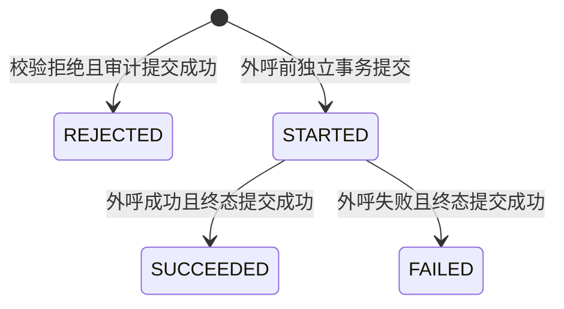

# US-1 数据模型

**日期**：2026-10-20 | **关联**：[接口](contracts/provider-api.md)、[配置](contracts/provider-config.md)

本文件描述计划契约，不是已存在的实体或迁移脚本。core 类型保持纯 Java；只有 storage 的 Entity 依赖 JPA。

## 领域对象

| 对象 | 字段及规则 | 生命周期 |
|---|---|---|
| ProviderDefinition | name、adapter、models、可选 baseUrl、credentialRef、maxRetries、connectTimeout、readTimeout | 启动快照；名称唯一、区分大小写；模型集合非空；重试为非负整数 |
| ProviderRegistration | definition、availability、内部 adapter 引用 | 启动建立；凭证缺失等使对应项不可用，不回退到其他项 |
| ModelRequest | messages、providerName、modelName、可选 generationOptions/tools | 单个逻辑请求；名称必填；messages 非空；选定模型必须属于配置集合 |
| ModelMessage | role、content、可选 toolCalls/toolCallId | 内存传输；支持 SYSTEM/USER/ASSISTANT/TOOL；工具响应必须关联调用 ID |
| ToolSchema | name、description、inputSchema | 唯一工具名、合法 JSON Schema；纯描述无执行体 |
| ModelResponse | requestId、providerName、modelName、content、toolCalls、finishReason、usage | 单次逻辑请求的成功结果；content 可为空但不能连同 toolCalls 都为空 |
| ToolCall | id、name、argumentsJson | 原样作为响应返回；不在 US-1 执行，也不写入审计 |
| TokenUsage | inputTokens、outputTokens、totalTokens | 每个字段可空、若存在必须非负；不把未知当 0，不推断未提供的总数 |
| ProviderFailure | requestId、code、可获得的 providerName/modelName、attemptCount、retryable、externalOutcome | 安全失败信息；不包含原始异常、端点、凭证或正文 |
| LlmCallAudit | 下表字段 | 唯一持久化业务实体，关联一个逻辑请求的一次尝试 |

`requestId` 由服务入口生成 UUID，不把它当上游去重令牌。不同调用即使请求内容相同也产生不同 requestId；US-1 不提供外部幂等保证。请求/响应正文及 Tool 参数仅在内存中流转。

## llm_calls 持久化字段

| 字段 | 逻辑类型 | 约束与含义 |
|---|---|---|
| id | UUID 字符串 | 主键，每次尝试唯一 |
| request_id | UUID 字符串 | 逻辑请求关联标识，非空 |
| attempt_no | 非负整数 | 外呼从 1 开始，校验拒绝使用 0；唯一约束 `(request_id, attempt_no)` |
| provider_name | 短字符串，可空 | 只保存通过格式验证且已注册的请求名称；缺失、未知或不安全值为空 |
| model_name | 短字符串，可空 | 同上且属于选定 Provider 的允许模型集合；记录请求选择，不擅自改成厂商返回别名 |
| status | 枚举 | STARTED、SUCCEEDED、FAILED、REJECTED |
| created_at | UTC 时间 | 非空；规范化 ISO-8601 文本保存 |
| completed_at | UTC 时间，可空 | STARTED 为空，正常终态非空 |
| duration_ms | 非负长整数，可空 | 用单调时钟测量；外呼耗时，未外呼的拒绝为 0 |
| input_tokens | 非负长整数，可空 | 上游提供时记录 |
| output_tokens | 非负长整数，可空 | 同上 |
| total_tokens | 非负长整数，可空 | 同上 |
| error_code | 稳定枚举，可空 | FAILED/REJECTED 必填，成功为空 |
| retryable | 布尔 | 此失败类别是否允许重试；不代表剩余额度，STARTED/成功/拒绝为 false |

按 request_id 建索引；不增加审计查询 REST API、Session 外键或厂商返回任意文本字段。未来 Session 关联通过新增可选字段演进，不让 US-1 依赖 Session。

## 状态与事务

终态不可回退。complete 使用 `id + STARTED` 条件更新，必须且只能更新一行；重试新建记录，不重用旧行。begin/complete 的方法返回必须位于事务提交之后；不能把 Provider 编排标注为跨网络事务。

| 故障位置 | 持久化结果 | 对外行为 |
|---|---|---|
| 第一次 begin 失败 | 可能无任何记录 | AUDIT_UNAVAILABLE，externalOutcome=NOT_SENT，零外呼 |
| 校验拒绝且记录可写 | 一行 REJECTED、attempt_no=0 | 返回原校验错误，零外呼 |
| 校验拒绝但记录不可写 | 不承诺落库 | 返回 AUDIT_UNAVAILABLE，零外呼 |
| 外呼失败且 complete 成功 | FAILED | 按类别和剩余额度决定是否新建下一次尝试 |
| 后续 begin 失败 | 旧尝试保留，新尝试不承诺有记录 | 停止；该次零外呼，不抹掉旧调用已发生的事实 |
| 任一 complete 失败 | 已提交 STARTED 可能保留，终态未确认 | AUDIT_UNAVAILABLE/UNKNOWN，不返回普通成功，不重试 |
| 进程在外呼附近退出 | STARTED 留存 | 重启不自动重放、不当成已失败或已成功 |

单次尝试获得完整上游响应不代表整个逻辑请求均已确认；请求级 externalOutcome 按[接口契约](contracts/provider-api.md)汇总。任意未确认尝试或外呼后的审计终态写入失败，均使最终失败返回 UNKNOWN。审计事务不是外部幂等机制。

## 校验与安全

- Provider 名称匹配 `[A-Za-z0-9][A-Za-z0-9._-]{0,63}`，模型匹配 `[A-Za-z0-9][A-Za-z0-9._:/-]{0,127}`；非法输入不原样写日志/审计。标识字段不得承载凭证。
- generationOptions 首批仅允许有限数字 temperature/maxOutputTokens，按适配器能力校验；禁止任意 map 覆盖模型、端点、凭证、重试或自动工具执行开关。
- messages、响应正文、Tool schema/arguments、API key、完整 baseUrl、认证 Header、原始异常均不入库。
- SQLite 文件位于 `.aegisos/aegisos.db`，目录按本机最小权限创建；数据库/运行产物应由版本控制忽略规则排除，规则补充属于实施任务。
- 初始化采用版本化 SQL 与 schema version 校验，失败不得忽略。单连接池/有限 busy timeout 适配 SQLite；事务提交、锁竞争、重开持久化必须用真实临时数据库验证，不能只用 H2 替代。
