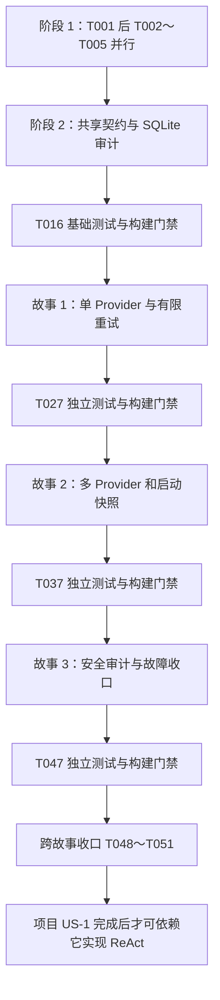

# 开发任务：US-1 LLM Provider 抽象

**日期**：2026-10-21 | **功能标识**：`002-provider-abstraction`

**输入**：[spec.md](spec.md)、[plan.md](plan.md)、[research.md](research.md)、[data-model.md](data-model.md)、[接口契约](contracts/provider-api.md)、[配置契约](contracts/provider-config.md)、[验证指南](quickstart.md)，以及 `.specify/memory/constitution.md` 1.0.1。

**状态**：Provider 实现、91 项测试、九模块打包、静态分析与秘密扫描已完成；T001～T051 均已验证；NVD 增量更新及依赖安全门禁已于 23:23 通过，项目 US-2 的 US-1 前置门禁已满足。现有九模块及任务开始前的工作区修改保留；验证证据见 [validation.md](validation.md)。路径均相对仓库根目录。

**标签说明**：项目路线中的 US-1 是整个 Provider 功能；本文件的 `[US1]`、`[US2]`、`[US3]` 分别对应本功能 spec 的用户故事 1、2、3，均为 P1。它们不代表项目路线中的 ReAct（US-2）或 Memory（US-3）。

**测试约定**：规格 FR-013/015 和宪法明确要求测试，因此本清单包含测试任务。每个故事先编写测试，补齐必要接口签名以使测试可编译，再确认测试因目标行为未实现而失败，最后实现并通过；不能把依赖下载失败、零测试发现或编译失败当成有效行为验证。所有自动测试命名为 `*Test` 并由 Surefire 运行。

**并行约定**：`[P]` 仅表示在注明的前置任务完成后，可与同批不同文件任务并行；无标记任务顺序执行。同一生产类的后续修改必须串行。本文不授权提交、推送或调用付费模型。

## 阶段 1：准备与依赖（T001～T005）

**目标**：复用九模块工程，落实 plan 选定的 Java 21、兼容依赖与测试发现机制。

- [X] T001 保留已获批准并落地的 Boot 4.1.1 / Framework 7.0.9 基线，不执行旧的 Boot 3 降级任务。按 research R1/R3 重新核对 Spring AI 2.0.1 的源码与依赖收敛后导入其 BOM，管理 SQLite JDBC 候选和与当前 Boot Hibernate core 同版的 community dialect；保留 Java 21、九模块、groupId 和 Surefire Jupiter 测试发现机制。本次不引入 DashScope/Alibaba Agent 依赖，后续新增依赖仍须通过依赖安全门禁。
- [X] T002 [P] 在 `aegisos-provider/pom.xml` 添加已核对的 Spring AI OpenAI model 与 Jupiter/Mockito 测试依赖；基于 AI 2 SDK 实际 API 选择禁用底层重试/自动工具执行所需依赖，不盲目沿用旧 RetryTemplate。保留对 core 的依赖，禁止新增 storage/memory/tool/web 依赖或自动选择默认模型的 starter；依赖 T001。
- [X] T003 [P] 在 `aegisos-storage/pom.xml` 添加 Spring Data JPA、SQLite JDBC、Hibernate community dialect 和测试依赖，方言与 Hibernate core 保持同版；保留原有依赖但审计代码不调用 Memory，测试不以 H2 替代 SQLite；依赖 T001。
- [X] T004 [P] 在 `aegisos-core/pom.xml` 和 `aegisos-boot/pom.xml` 配置 Jupiter 与 Spring Boot Test 所需测试依赖，core 主代码不添加 Spring AI/JPA 依赖；复用已有 boot 打包插件及 mainClass；依赖 T001。
- [X] T005 [P] 在 `.gitignore` 增补各模块 `target/`、本地凭证配置、`.aegisos/` 运行目录及 SQLite 数据/WAL/SHM 文件的忽略规则；不得移除用户已有规则或把真实秘密写入示例；依赖 T001。

**检查点**：T002～T005 可在 T001 完成后并行，合并后才能进入共享基础。

## 阶段 2：共享基础（T006～T016，阻塞全部故事）

**目标**：稳定 core 契约、配置模型和真实 SQLite 审计端口，确保最早的模型调用也有持久审计门槛。

- [X] T006 在 `aegisos-core/src/main/java/com/aegisos/core/provider/ModelRequest.java`、`ModelMessage.java`、`GenerationOptions.java`、`ToolSchema.java`、`ToolCall.java` 定义请求与消息 DTO；保留数据模型约束原文：“单个逻辑请求；名称必填；messages 非空；选定模型必须属于配置集合”“支持 SYSTEM/USER/ASSISTANT/TOOL；工具响应必须关联调用 ID”“唯一工具名、合法 JSON Schema；纯描述无执行体”；ToolCall 字段为 id/name/argumentsJson，满足“原样作为响应返回；不在 US-1 执行，也不写入审计”；“generationOptions 首批仅允许有限数字 temperature/maxOutputTokens，按适配器能力校验；禁止任意 map 覆盖模型、端点、凭证、重试或自动工具执行开关”。无效请求应能由服务生成 requestId 并审计拒绝，不在 DTO 构造阶段绕过服务拒绝路径。
- [X] T007 在 `aegisos-core/src/main/java/com/aegisos/core/provider/ModelResponse.java` 和 `TokenUsage.java` 定义 requestId/providerName/modelName/content/toolCalls/finishReason/usage 及用量字段；逐字落实“content 可为空但不能连同 toolCalls 都为空”“每个字段可空、若存在必须非负；不把未知当 0，不推断未提供的总数”；依赖 T006。
- [X] T008 在 `aegisos-core/src/main/java/com/aegisos/core/provider/ProviderService.java`、`ProviderFailure.java`、`ProviderException.java`、`ProviderErrorCode.java`、`ExternalOutcome.java` 定义同步 `chat(ModelRequest)` 和契约列出的全部错误码；failure 包含 requestId/code/providerName/modelName/attemptCount/retryable/externalOutcome，落实“不包含原始异常、端点、凭证或正文”；externalOutcome 仅 NOT_SENT/RESPONDED/UNKNOWN，异常不得保留可打印的原始 SDK cause；同时在 `aegisos-provider/src/main/java/com/aegisos/provider/adapter/ProviderAdapter.java` 定义单次模型调用接口，输入/输出仅使用 core 的请求、响应和安全异常类型；接口不包含重试、审计、工具执行或 ReAct 编排，具体实现留给 T022；依赖 T006、T007。
- [X] T009 [P] 在 `aegisos-core/src/main/java/com/aegisos/core/audit/LlmCallAuditStore.java` 及同目录 `AuditHandle.java`、`AuditStart.java`、`AuditCompletion.java`、`AuditRejection.java`、`AuditStatus.java`、`AuditUnavailableException.java` 定义 begin/complete/reject 契约，状态为“STARTED、SUCCEEDED、FAILED、REJECTED”；begin 返回须代表已提交，complete/reject 返回须代表终态已提交；不引用 JPA 或暴露 SQL/连接串；依赖 T008。
- [X] T010 [P] 在 `aegisos-provider/src/main/java/com/aegisos/provider/config/ProviderDefinition.java`、`ProviderRegistration.java` 定义无可打印秘密的启动快照与可用状态，字段包含 name/adapter/models/baseUrl/credentialRef/maxRetries/connectTimeout/readTimeout；逐字落实“名称唯一、区分大小写；模型集合非空；重试为非负整数”“凭证缺失等使对应项不可用，不回退到其他项”；Provider 名称匹配 `[A-Za-z0-9][A-Za-z0-9._-]{0,63}`、模型匹配 `[A-Za-z0-9][A-Za-z0-9._:/-]{0,127}`；此任务仅定义模型，凭证解析/注册在故事 2 实现；ProviderRegistration 包含 ProviderDefinition、可用状态和 ProviderAdapter 引用；可用注册项必须具有适配器，不可用注册项允许适配器为空，但必须保留安全的不可用原因；依赖 T008。
- [X] T011 在 `aegisos-storage/src/main/resources/db/schema/sqlite/V001__llm_calls.sql`、`aegisos-storage/src/main/java/com/aegisos/storage/audit/LlmCallEntity.java`、`LlmCallRepository.java` 定义一张审计表及 JPA 映射：id 为“主键，每次尝试唯一”的 UUID 字符串；request_id 为“逻辑请求关联标识，非空”；attempt_no 为“外呼从 1 开始，校验拒绝使用 0；唯一约束 `(request_id, attempt_no)`”；provider_name/model_name 为“短字符串，可空”，分别遵守“只保存通过格式验证的请求名称；缺失/不安全值为空”“记录请求选择，不擅自改成厂商返回别名”，长度上限 64/128；status 为“STARTED、SUCCEEDED、FAILED、REJECTED”；created_at 为“非空；规范化 ISO-8601 文本保存”；completed_at 为“STARTED 为空，正常终态非空”；duration_ms 为“非负长整数，可空”“用单调时钟测量；外呼耗时，未外呼的拒绝为 0”；input_tokens/output_tokens/total_tokens 均为“非负长整数，可空”“上游提供时记录”；error_code 为“稳定枚举，可空”“FAILED/REJECTED 必填，成功为空”；retryable 表示“此失败类别是否允许重试；不代表剩余额度，STARTED/成功/拒绝为 false”；按 request_id 建索引，除配置/schema 版本元数据外不新增业务表，不添加正文列或 Session 外键；依赖 T009。
- [X] T012 在 `aegisos-storage/src/test/java/com/aegisos/storage/audit/JpaLlmCallAuditStoreTest.java` 编写真实临时文件 SQLite 契约测试，覆盖 V001 初始化/重复启动/schema 版本错误、唯一键与字段约束、null 用量、begin 后另一连接可见、同一行完成且终态不可回退、complete 条件更新零行/多次调用失败、关闭重开持久化、遗留 STARTED 不自动重放；记录行为失败后再执行 T013/T014；依赖 T011。
- [X] T013 在 `aegisos-storage/src/main/java/com/aegisos/storage/audit/AuditSchemaInitializer.java` 和 `AuditStorageConfiguration.java` 实现版本化 SQL 初始化与 schema version 校验；文件路径为 `.aegisos/aegisos.db`，目录“按本机最小权限创建”；配置 SQLiteDialect、单连接池、有限 busy timeout，禁止 `ddl-auto=update`、失败静默继续和内存回退；错误转安全审计不可用；依赖 T012。
- [X] T014 在 `aegisos-storage/src/main/java/com/aegisos/storage/audit/JpaLlmCallAuditStore.java` 实现端口：begin/complete/reject 使用独立短事务，事务提交后方法才返回；通过独立事务 Bean 或 TransactionTemplate 避免自调用绕过代理；落实“终态不可回退”“complete 使用 `id + STARTED` 条件更新，必须且只能更新一行；重试新建记录，不重用旧行”，禁用隐式合并重复记录；通过 T012，Provider 编排不得持数据库事务；依赖 T013。
- [X] T015 在 `aegisos-core/src/test/java/com/aegisos/core/provider/ProviderContractTest.java` 与 `aegisos-provider/src/test/java/com/aegisos/provider/config/ProviderDefinitionTest.java` 验证 T006～T010 的字段/枚举/正则/空值边界及接口无框架类型，断言无效请求可交由服务拒绝审计；必要修正对应模型并保持既定契约，运行相关 core/provider/storage 测试；依赖 T014。
- [X] T016 在 `specs/002-provider-abstraction/validation.md` 建立实际执行证据记录，运行 `mvn -pl aegisos-core,aegisos-provider,aegisos-storage -am test` 与 `mvn clean package`，核对 Surefire 实际发现 core/provider/storage 测试且无失败、九模块打包成功、effective POM 中 Hibernate core/dialect 同版；失败则阻塞故事开发，不得以下载成功/零测试代替验证；依赖 T015。

**并行窗口**：阶段 1 通过后依次完成 T006～T008；T008 完成后，T009 审计契约与 T010 Provider 配置模型可并行，二者完成后按序执行 T011～T016。T016 通过前不得发起任何故事的实现。

## 阶段 3：故事 1——调用已配置的 LLM Provider（P1，首个 MVP）

**目标**：通过手工构造的单个命名注册项，完成非流式文本/schema 请求、模型响应、有限重试和持久审计；生产配置绑定在故事 2 接入。

**独立验收**：本地 HTTP stub + 真实 SQLite + ProviderService，无 ReAct/Memory/Tool/Web 业务 Bean；成功保留身份/用量、缺用量为 null，每次真实发送一条审计，默认一次尝试、配置 2 次重试最多三次发送；不可重试错误只发送一次。

### 先编写测试

- [X] T017 [P] [US1] 在 `aegisos-provider/src/test/java/com/aegisos/provider/service/ProviderServiceTest.java` 定义同步调用契约测试：手工注册单 Provider、明确模型、稳定 UUID requestId、成功/失败身份、用量缺失、开始审计→单次模型→完成审计的顺序；不同逻辑请求生成不同 UUID，不把 requestId 当外部幂等键；依赖 T016。
- [X] T018 [P] [US1] 在 `aegisos-provider/src/test/java/com/aegisos/provider/service/ProviderRetryTest.java` 编写本地 HTTP stub 请求计数测试：默认 0、配置 2 后两次临时失败再成功/耗尽、重试同一身份、每次独立审计和序号、固定 100ms 等待器可替换；400/401/403/429/5xx、协议/TLS/配置错误不自动重试，读超时结果为 UNKNOWN；计数取 stub 实际接收数，不能只统计 adapter mock；依赖 T016。
- [X] T019 [P] [US1] 在 `aegisos-provider/src/test/java/com/aegisos/provider/adapter/OpenAiCompatibleAdapterTest.java` 编写协议测试：API 根路径只追加 `/v1/chat/completions` 一次、SYSTEM/USER/ASSISTANT/TOOL 消息关联、生成参数白名单、请求模型覆盖 SDK 默认、文本/Tool 混合与仅 Tool 响应、结构化参数保留、schema 不支持时明确拒绝；无工具自动执行、无自动第二轮，工具执行计数为零；依赖 T016。

### 实现与集成

- [X] T020 [US1] 在 `aegisos-provider/src/main/java/com/aegisos/provider/adapter/OpenAiMessageMapper.java` 实现 T019 的消息/schema/生成参数/响应转换；按 AI 2 的实际配置 API 强制关闭自动工具执行（research R3），不向 SDK 注册可执行回调；合法 ToolCall 原样返回，空文本且无 ToolCall 返回 PROVIDER_PROTOCOL_ERROR；messages/响应/schema/arguments 仅在内存流转；依赖 T017～T019。
- [X] T021 [US1] 在 `aegisos-provider/src/main/java/com/aegisos/provider/adapter/OpenAiClientFactory.java` 显式构造每个注册项的 OpenAiChatModel，依据 research R3 核实的 AI 2 / OpenAI Java 客户端 API 将 SDK 重试设为零，关闭 HTTP 层独立重发并设置正数连接/读取超时；不使用全局重试参数替代实例配置，不允许请求参数开启自动工具执行，stub 验证一次 adapter 调用至多一次真实发送；依赖 T020。
- [X] T022 [US1] 在 `aegisos-provider/src/main/java/com/aegisos/provider/adapter/OpenAiCompatibleAdapter.java` 实现 T008 定义的 ProviderAdapter，组合 T020/T021 完成一次模型请求；响应保留请求选择的 Provider/模型和可用 TokenUsage，明确 schema 不支持错误，不执行工具、循环或回退；依赖 T021。
- [X] T023 [US1] 在 `aegisos-provider/src/main/java/com/aegisos/provider/service/ProviderErrorClassifier.java` 映射契约全部安全错误，认证/参数/模型下线/限流/HTTP/协议/证书或 DNS 配置错误均不重试，仅确认的临时连接拒绝/重置/读写超时可重试，未知类别保守不重试；不透出原始响应体/异常，维护 NOT_SENT/RESPONDED/UNKNOWN；依赖 T022。
- [X] T024 [US1] 在 `aegisos-provider/src/main/java/com/aegisos/provider/service/DefaultProviderService.java` 实现单次逻辑请求和审计生命周期，先生成 requestId、验证显式字段、begin 提交后才调用 adapter、以单调时钟计耗时并 complete；审计拒绝/失败不可吞掉，complete 失败返回 AUDIT_UNAVAILABLE/UNKNOWN、不返回成功或重发；本阶段可注入单个命名注册项，完整注册表解析在 T034 接入；依赖 T023。
- [X] T025 [US1] 在 `aegisos-provider/src/main/java/com/aegisos/provider/service/DefaultProviderService.java` 与 `RetryWaiter.java` 实现 AegisOS 外层有限重试：默认 0，N 最多 N+1，避免溢出；仅失败终态已持久化且类别可重试、有额度时等待 100ms 再 begin；重试创建新行、不更换 Provider/模型，attemptCount 为实际尝试数；审计失败立即终止；通过 T017～T019；依赖 T024。
- [X] T026 [US1] 在 `aegisos-boot/src/test/java/com/aegisos/boot/config/ProviderWiringTest.java` 用显式测试 Bean 构造单 ProviderService、真实 JPA/SQLite 和 loopback HTTP stub，验证一次成功及默认不重试失败的完整链路、审计持久化和无其他业务服务依赖；本阶段不依赖尚未实现的生产配置绑定；依赖 T025。
- [X] T027 [US1] 在 `specs/002-provider-abstraction/validation.md` 记录故事 1 独立验收，运行 `mvn -pl aegisos-provider,aegisos-storage -am test`、`mvn -pl aegisos-boot -am -Dtest=ProviderWiringTest -Dsurefire.failIfNoSpecifiedTests=false test`、`mvn test`、`mvn clean package`；核对指定 boot 测试实际存在、实际 HTTP 计数、每次一条审计和测试数量；失败不得开始依赖故事；依赖 T026。

**检查点**：T027 通过得到内部可验证 MVP，仍不是整个项目 US-1 完成。生产配置、多 Provider 和故事 3 的安全故障验收仍需完成。

## 阶段 4：故事 2——显式选择多个 Provider（P1）

**目标**：生产配置构造不可变命名注册表，明确 Provider/模型选择及启动/重启生效边界。

**独立验收**：同时启动两个同协议 HTTP stub，通过指定 A/B 分别只访问对应端点；未知/缺失 Provider 或模型、缺凭证等拒绝场景零外呼；重名拒绝启动。运行中修改配置/环境来源不影响旧客户端，重建上下文后采用新配置。

### 先编写测试

- [X] T028 [P] [US2] 在 `aegisos-provider/src/test/java/com/aegisos/provider/config/ProviderRegistryTest.java` 使用两个同协议不同端点的真实 HTTP stub 验证显式路由、大小写、未知/缺失名称、未知/缺失模型、不可用 Provider、不 fallback/不取默认模型；拒绝时审计可写则单行 REJECTED，stub 零请求；依赖 T027。
- [X] T029 [P] [US2] 在 `aegisos-boot/src/test/java/com/aegisos/boot/config/ProviderConfigurationTest.java` 编写配置契约测试：列表重名/绑定失败阻止启动，单条缺密钥/未知 adapter/空模型不可用，env 引用格式和 URI 安全规则、默认值及非负重试/正数超时校验、无启动模型探测；依赖 T027。
- [X] T030 [P] [US2] 在 `aegisos-boot/src/test/java/com/aegisos/boot/config/ProviderSnapshotTest.java` 注入可控环境来源与配置文件，验证运行期间修改名称/模型/端点/凭证引用及凭证值均不改变现有客户端，关闭并重建上下文后新配置生效；断言旧/新 stub 请求计数而非只比较配置对象；依赖 T027。

### 实现与集成

- [X] T031 [US2] 在 `aegisos-boot/src/main/java/com/aegisos/boot/config/EnvironmentCredentialResolver.java` 实现首批 `env:变量名` 引用，仅启动解析一次；凭证不进入可打印 DTO，缺失/空值/错误引用使对应项不可用，不进行未认证外呼；不实现受控密钥服务管理或动态轮换；依赖 T028～T030。
- [X] T032 [US2] 在 `aegisos-provider/src/main/java/com/aegisos/provider/config/ProviderRegistry.java` 从列表校验重名并建立不可变 name→registration 映射，保留不可用项的安全状态；精确匹配请求 Provider/模型，不 trim 猜测、不按 Bean 类型/顺序选供应商，支持同 adapter 多实例；依赖 T031。
- [X] T033 [US2] 在 `aegisos-boot/src/main/java/com/aegisos/boot/config/ProviderProperties.java` 绑定 `aegisos.providers` 列表并转为启动快照；落实 name 必填唯一/区分大小写、models 为“非空显式允许集合；不得把集合首项作为默认请求模型”；base-url 可省略默认 `https://api.openai.com`，只允许无 userInfo/query/fragment 的 HTTPS URI、测试 profile 仅 loopback HTTP；max-retries“非负整数，默认 0；N 表示最多 N+1 次外呼。计算避免整数溢出，配置非法不得悄悄归零”；connect-timeout/read-timeout 分别“正数时长，默认 5s”“正数时长，默认 60s”；非法字段不输出原始配置；依赖 T032。
- [X] T034 [US2] 在 `aegisos-provider/src/main/java/com/aegisos/provider/service/DefaultProviderService.java` 接入 ProviderRegistry；缺名称/模型、未知组合、注册项不可用均在外呼前拒绝，模型已下线按上游错误映射；只使用请求显式身份，不让 SDK 默认项介入；保留已有审计、重试、用量与故障行为，通过 T028；依赖 T033。
- [X] T035 [US2] 在 `aegisos-boot/src/main/java/com/aegisos/boot/config/ProviderConfiguration.java` 装配 Properties→凭证解析→显式客户端→不可变 Registry→ProviderService，并注入 core 审计端口；显式导入 storage 的审计配置与 Entity/Repository 扫描，不能依赖当前 `com.aegisos.boot` 默认扫描找到兄弟包；初始化失败不允许模型调用，不扫描 `ChatModel` 猜身份、不加载 Agent Profile/Watcher；依赖 T034。
- [X] T036 [US2] 在 `aegisos-boot/src/main/resources/application.properties` 和 `aegisos-boot/src/test/resources/application-provider-test.properties` 增加不含秘密的 Provider 配置结构与测试 profile，使用环境变量引用、测试 stub 动态端口、关闭正文观测及 JPA 自动 DDL；保留已有属性，不新建冲突的并行 application.yaml；通过 T029/T030 并将 ProviderWiringTest 切换到生产装配入口；依赖 T035。
- [X] T037 [US2] 在 `specs/002-provider-abstraction/validation.md` 记录故事 2 A/B 路由、零外呼拒绝、重名和重启配置对照，运行聚焦 provider/storage/boot 测试、完整 `mvn test` 和 `mvn clean package`；前两故事测试均须通过，保留 Surefire 实际数量与 stub 计数；依赖 T036。

**检查点**：T037 通过后，任意一个场景可由本地配置独立复现，不需 Profile 或 ReAct。故事 3 使用已验证的生产注册/调用路径进行故障注入。

## 阶段 5：故事 3——安全且可观测地调用（P1）

**目标**：完成拒绝审计、首次/后续审计故障、外呼后结果未确认、持久化与全路径秘密保护；不把模型调用视为可被数据库事务撤回。

**独立验收**：成功/拒绝/失败每次一行安全审计；前置失败对应尝试零外呼；终态失败不返回成功、不重试；重启保留记录不重放；秘密哨兵在数据库、日志、异常和生成物中命中数零。

### 先编写测试

- [X] T038 [P] [US3] 在 `aegisos-provider/src/test/java/com/aegisos/provider/service/ProviderAuditFailureTest.java` 注入第一次 begin、后续重试 begin、reject、成功后 complete、网络失败后 complete 的故障：该次前置失败零发送，旧尝试保留，后续失败不能将整个请求标为 NOT_SENT；终态失败为 AUDIT_UNAVAILABLE/UNKNOWN、不返回成功/不重试；审计不可写不伪称拒绝已落库；增加 `contracts/provider-api.md` 请求级汇总验收表中的六个场景测试，断言后续结果不会覆盖此前的不确定性；依赖 T037。
- [X] T039 [P] [US3] 在 `aegisos-storage/src/test/java/com/aegisos/storage/audit/AuditStorageFailureTest.java` 使用临时文件 SQLite 验证显式写锁与有限 busy timeout、只读/不可写路径、连接错误、提交失败，结合可控故障适配器避免仅依赖平台 chmod；重开后终态仍在、STARTED 不重放；begin 返回后调用线程等待时另一连接仍可写，证明存储方法未遗留事务；真实模型等待场景由 T046 的 boot 测试验证，不为 storage 添加 provider 依赖；依赖 T037。
- [X] T040 [P] [US3] 在 `aegisos-boot/src/test/java/com/aegisos/boot/config/ProviderSecurityTest.java` 运行时生成凭证/消息/模型输出/上游错误体/URL 异常哨兵，覆盖成功、拒绝、网络/认证/协议/审计失败并捕获 SDK 与应用日志，检查 SQLite 行、异常 message/toString/堆栈和生成的测试报告均无敏感值；Tool schema/arguments 不入审计，非法身份不原样记录，测试断言不得输出哨兵；依赖 T037。

### 实现与集成

- [X] T041 [US3] 在 `aegisos-provider/src/main/java/com/aegisos/provider/service/AuditMetadataPolicy.java` 集中生成安全审计元数据和经格式校验的身份；遵守“messages、响应正文、Tool schema/arguments、API key、完整 baseUrl、认证 Header、原始异常均不入库”，缺失/非法 Provider/模型写 null；禁止标识承载秘密、任意异常文本或请求数据成为审计补充字段；依赖 T038～T040。
- [X] T042 [US3] 在 `aegisos-provider/src/main/java/com/aegisos/provider/service/DefaultProviderService.java` 统一所有外呼前请求拒绝路径，以稳定 requestId 写单行 REJECTED/attempt_no=0；缺少身份允许审计字段 null，duration=0；reject 写失败改为 AUDIT_UNAVAILABLE/NOT_SENT，不声称已落库、不尝试外呼；使用 T041 元数据策略，保持请求错误可执行；依赖 T041。
- [X] T043 [US3] 在 `aegisos-provider/src/main/java/com/aegisos/provider/service/DefaultProviderService.java` 收口全部审计故障分支：前置失败中断该次尝试，保留之前的真实 attemptCount/outcome；complete 失败保留已提交 STARTED 并返回 AUDIT_UNAVAILABLE/UNKNOWN、不产生重试；严格按接口契约汇总 externalOutcome：UNKNOWN 不得被后续响应覆盖；没有任何外呼才能返回 NOT_SENT；无不确定尝试且收到完整响应时返回 RESPONDED；通过 T038，禁止补偿重发或把遗留记录改成确定失败；依赖 T042。
- [X] T044 [US3] 在 `aegisos-storage/src/main/java/com/aegisos/storage/audit/JpaLlmCallAuditStore.java` 和 `AuditStorageConfiguration.java` 统一锁/连接/磁盘/提交故障为安全异常，验证事务确实回滚且旧行不删除，初始化失败不降级到内存/日志；完善目录最小权限与有限等待；通过 T039，不添加 Provider 逻辑或跨网络事务；依赖 T043。
- [X] T045 [US3] 在 `aegisos-provider/src/main/java/com/aegisos/provider/adapter/OpenAiClientFactory.java`、`aegisos-provider/src/main/java/com/aegisos/provider/service/ProviderErrorClassifier.java` 和 `aegisos-boot/src/main/resources/application.properties` 关闭框架/HTTP wire/request/response/认证头观测并修正异常映射泄漏；不打印配置对象、完整 URL、上游正文/原始 cause，只保留安全身份/requestId/类别；通过 T040，不能靠关闭测试捕获或放宽安全断言通过；依赖 T044。
- [X] T046 [US3] 在 `aegisos-boot/src/test/java/com/aegisos/boot/config/ProviderWiringTest.java` 扩展生产装配集成验证：模型 stub 处理请求时另一数据库连接可见 STARTED，失败存储对应零外呼，模型阻塞时并行数据库写提交，成功后终态异常只发生一次真实发送；无 AgentService/ReActLoop/MemoryService/ToolExecutor/Web Controller，工具执行计数为零；依赖 T045。
- [X] T047 [US3] 在 `specs/002-provider-abstraction/validation.md` 记录成功/拒绝/失败安全审计、故障阶段、持久化、秘密哨兵与独立装配证据，运行聚焦测试、完整 `mvn test` 和 `mvn clean package`；核对三个故事全部回归，任一失败不得声明项目 US-1 完成；依赖 T046。

## 阶段 6：跨故事收口（T048～T051）

- [X] T048 在 `specs/002-provider-abstraction/quickstart.md` 和 `contracts/provider-config.md` 校准实际配置键、测试类、环境引用与启动重启行为，并在 `README.md` 增加到验证指南的入口；仅把已验证行为写为实现，保持中文，不加入真实凭证、US-1 不存在的 CLI/REST 命令或真实厂商调用成功声明；依赖 T047。
- [X] T049 在 `specs/002-provider-abstraction/validation.md` 记录 effective POM/依赖树检查，确认仍为九模块、core 无 Spring AI/JPA、provider 不依赖 storage/memory/tool/web、Hibernate core/dialect 同版、无 SDK/HTTP 隐式重试与 Tool 自动执行；执行现有秘密扫描工具或无敏感输出的定向哨兵扫描，检查本次源码/文档/配置及展开后的打包产物，真实凭证不得采集或打印；不能用文件忽略规则替代内容扫描；依赖 T048。
- [X] T050 按 `specs/002-provider-abstraction/quickstart.md` 执行聚焦 provider/storage 测试、显式 ProviderWiringTest、完整 `mvn test` 和 `mvn clean package`，核对各测试报告数量大于零、失败/错误为零、全部 reactor SUCCESS；在 `specs/002-provider-abstraction/validation.md` 记录命令/时间/退出码/测试数量和本地 stub 调用数，禁止 skipTests 与零测试掩盖；依赖 T049；之后若修改代码，重跑受影响检查。
- [X] T051 在 `specs/002-provider-abstraction/validation.md` 完成 FR-001～FR-016（含 FR-006a/b）、SC-001～SC-009 逐项证据对照，限定 SC-003 为审计可写、SC-009 为对应尝试前置失败；真实 DeepSeek/Kimi 调用未执行标为 NOT_RUN，单独列明；同步本文件任务完成状态前核实每项产物与结果，不把本地 stub 通过写成真实厂商/部署验证，全部门禁通过才允许项目 US-2 ReAct 依赖；依赖 T050。

## 依赖与执行顺序

- 三个故事同为 P1，但本实施策略依次推进：故事 2 扩展故事 1 的调用服务，故事 3 对已完成生产装配做故障验证。同类服务文件共享，因此故事之间不标可并行。
- 每个故事的独立测试指可用本地 stub/数据库单独复现场景，不表示免除基础设施和前序代码依赖；不需要实现其他项目故事。
- 基础层提供最小安全错误与持久审计，不延后到故事 3；故事 3 完成更严格的故障注入与全路径安全验证。
- 标记 `[P]` 的测试编写任务只并行修改各自文件；共同生产类实现必须等该批测试定义稳定后再串行修改。

## 每个故事的并行示例

| 窗口 | 可同时执行 | 进入条件与退出条件 |
|---|---|---|
| 准备 | T002 Provider POM、T003 Storage POM、T004 Core/Boot 测试依赖、T005 忽略规则 | T001 完成；改不同文件，全部完成后进入阶段 2 |
| 基础 | T009 审计契约、T010 Provider 配置模型 | T008 完成；接口已定义、改不同文件，二者完成后进入 T011 |
| 故事 1 | T017 调用契约测试、T018 重试测试、T019 协议测试 | T016 通过；不同时修改 DefaultProviderService，测试合并后才做 T020 |
| 故事 2 | T028 Registry 测试、T029 绑定测试、T030 快照测试 | T027 通过；共享生产修改从 T031 串行推进 |
| 故事 3 | T038 审计门槛测试、T039 SQLite 故障测试、T040 秘密保护测试 | T037 通过；无共享日志/stub 全局状态，均使用独立端口、临时文件和捕获器 |

共 15 项任务标记 `[P]`，可并行的批次不得跨越前置门禁；本文件只说明机会，不代表已启动并行执行。

## 需求覆盖索引

| 需求/验收 | 主要任务 |
|---|---|
| FR-001、FR-007 | T006～T008、T017、T020～T026 |
| FR-002～FR-005、SC-001/002 | T010、T028/029、T031～T036 |
| FR-006/006a、SC-006 | T018、T021、T023、T025 |
| FR-006b、SC-008 | T006、T028、T034 |
| FR-008/009/016、SC-003/009 | T009、T011～T014、T024、T038/039、T041～T046 |
| FR-010/011、SC-004 | T005、T008、T031、T040/041、T045、T049 |
| FR-012 | T006、T019～T022、T046 |
| FR-013/015、SC-005 | T001～T004、T015/016、T027/037/047、T049～T051 |
| FR-014、SC-007 | T029/030、T033、T035/036 |

## 实施策略与完成口径

1. 先完成依赖及共享审计，T016 通过后实现故事 1；T027 是第一个可审查的内部 MVP，不提供 ReAct Demo 或 Web 服务。
2. 完成多 Provider 与启动快照后，用安全故事覆盖故障和秘密保护；每阶段按矩阵独立验收并回归前序故事。
3. 最终执行完整验证指南和逐项覆盖对照；任务清单完成不等于功能实现完成，打包成功不等于真实厂商、部署或业务验收通过。
4. 范围保持 core/provider/storage/boot 与根构建配置；不扩十四模块、不实现 ReAct/Memory/Tool 执行/Sandbox/Web 端点/审计查询服务。后续工具必须遵守 Sandbox 宪法约束。

**任务统计**：准备 5，共享基础 11，故事 1 共 11，故事 2 共 10，故事 3 共 10，收口 4；合计 51 项，已完成 51 项；T051 的依赖安全门禁于 2026-10-21 23:23 通过。
