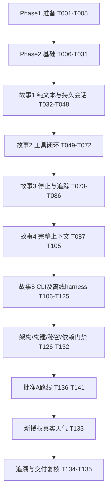

# 任务清单：US2 ReAct 循环与课程第 17 节对齐

**日期**：2026-10-22　**功能目录**：`specs/003-react-loop`　**生成时实际 Git 分支**：`main`

**输入**：[plan.md](plan.md)、[spec.md](spec.md)、[research.md](research.md)、[data-model.md](data-model.md)、[contracts/acceptance.md](contracts/acceptance.md)、其余四份契约及 [quickstart.md](quickstart.md)。

**状态**：141/141项完成。T133经新授权执行的新A路线真实天气验收PASS（3模型发送/1GET、零重试、同会话两处理完成）；T134追溯与T135一致性复核完成。首次FAIL历史保留，全部工程门禁通过。实际证据见validation.md；保留002/005历史，未迁移个人库、提交/推送或启动后续故事。

## 格式与执行约定

- 每项使用 `- [ ] Tnnn [P?] [USn?] 描述及精确文件路径`。`[P]` 仅表示下文指定的同批独立文件任务可并行，必须先满足前置任务，不授权跨门禁抢跑。
- **[US1]～[US5] 指本规格的五个用户故事**，不表示项目的 Provider/ReAct/Memory/Tool/Web 五大阶段。本功能整体仍是项目 US2；现有002 Provider的51项任务和005历史原样保留。
- 路径均相对仓库根；任务中列出的新类/脚本是待创建目标。现有工程固定Java21、Boot4.1.1、SpringAI2.0.1、九模块，不重新初始化或升级基线。
- 规格与宪法明确要求测试，因此包含契约、行为、事务与集成测试。每批先写测试并确认因目标行为缺失而失败，不把编译失败/零发现当作失败证据；可先建立最小可编译契约/类外壳，不以测试替身冒充生产实现。
- 每故事门禁须核对本轮XML中的指定类、tests>0、零failure/error/skip及Maven真实退出码；聚焦reactor命令容许上游无匹配时仍必须检查目标发现数。行为失败阻断依赖故事。
- 关键代码必须有详细中文注释，解释事务提交、状态边界、容量单位、ID投影、路径/DNS与敏感检查。凭据仅环境或受控存储；只用合成密钥作测试哨兵。
- 标记完成必须有真实文件及对应证据。`validation.md` 由实施阶段首次建立并增量记录，不把本清单或旧PASS当作本轮验证。所有实现默认零真实模型/天气请求。

## Phase 1：准备（共享工程设置）

**目标**：确认真实基线、测试依赖与隔离夹具；不扩模块、不调用外部模型。

- [X] T001 在 `specs/003-react-loop/validation.md` 建立本轮记录，核对 `pom.xml`、`AGENT.md`、九模块、当前Git工作区及002/005历史；记录输入版本/初始状态和明确尚未执行项，不覆盖已有修改或复制秘密。
- [X] T002 在 `aegisos-tool/pom.xml` 显式声明Boot BOM管理的 `httpclient5` 与Jackson3依赖，在 `aegisos-memory/pom.xml`、`aegisos-tool/pom.xml`、`aegisos-cli/pom.xml`、`aegisos-channel-cli/pom.xml` 补齐JUnit/AssertJ测试依赖；保留 `aegisos-core/pom.xml` 无Spring/JPA/HTTP实现依赖和九模块DAG，不独立指定新运行库版本。
- [X] T003 [P] 在 `aegisos-core/src/test/java/com/aegisos/core/support/ReactTestFixtures.java` 建立固定响应序列Provider、Clock、事件计数及合成敏感哨兵夹具，先仅依赖现有公共类型/JDK、后续随新契约扩展，明确逻辑请求/接受响应/物理attempt分别计数，不读取真实环境凭据。
- [X] T004 [P] 在 `aegisos-boot/src/test/java/com/aegisos/boot/support/ReactRuntimeFixture.java` 建立临时工作区/SQLite、回环服务、可控DNS函数、故障提交及关闭重开夹具；先仅依赖现有公共类型/JDK，后续注入显式测试授权策略，每例隔离，不读或迁移个人 `.aegisos`，不把测试工具放入生产扫描。
- [X] T005 核对T002～T004后执行现有Maven test/package基线，在 `specs/003-react-loop/validation.md` 记录发现数/退出码与依赖图；基线失败先定位修复，不借初始化删除旧Provider测试或降低门禁。

**检查点**：工程与默认测试基线可用。T003/T004仅在T002完成后并行。

## Phase 2：基础能力（阻断所有故事）

**目标**：先固定公共边界、数据约束、安全/容量及最小可用上下文。此阶段未完成，不开始故事实现。

### 公共契约与模型

- [X] T006 [P] 在 `aegisos-core/src/main/java/com/aegisos/core/agent/AgentRequest.java`、`ProcessingHandle.java`、`ProcessingResult.java`、`ProcessingStatus.java` 定义公共对象及安全错误：保留“processId：UUID；sessionId；profileName；runtimeInstanceId；版本”“可空最终安全回复；固定 errorCode；持久化确认标记”，状态仅RUNNING/COMPLETED/MAX_ITERATIONS/FAILED/INTERRUPTED；“COMPLETED 仅在终态提交后返回”，toString不含正文。
- [X] T007 [P] 在 `aegisos-core/src/main/java/com/aegisos/core/memory/SessionSnapshot.java`、`ModelTurn.java`、`ExchangeGroup.java`、`ContextHistory.java` 定义不可变消息/组视图，逐项落实“sessionId：运行时 UUID 字符串；profileName：已注册精确名称”“iterationNo（从 1 开始）”“可空 requestId”“类型、OPEN/CLOSED、expected/committedObservationCount”；会话身份继续满足“1～64 位 ASCII”，不接受外部指定处理身份。
- [X] T008 [P] 在 `aegisos-core/src/main/java/com/aegisos/core/tool/AegisTool.java`、`ToolExecutor.java`、`Sandbox.java`、`ToolRegistryView.java`、`ToolObservation.java` 与 `aegisos-core/src/main/java/com/aegisos/core/audit/ToolInvocationAuditStore.java` 固定统一工具/授权/审计端口，落实“callId 仅接受 1～128 位 `[A-Za-z0-9_.-]`”“原始 callId、name、success、errorCode、externalOutcome、受限 data”，无效身份不原样回显、自由异常不作为观察。
- [X] T009 [P] 在 `aegisos-core/src/main/java/com/aegisos/core/context/AgentSource.java`、`AgentSourceRegistry.java`、`SensitiveContentGuard.java`、`ContextBudget.java` 固定来源/安全/容量契约，保留“profileName、工作区规范根、启动真实 Agent 目录、相对目录”；来源仅启动快照，guard不暴露密钥，必填容量单位为规范JSON的UTF-8字节。
- [X] T010 [P] 在T006～T009后于 `aegisos-core/src/main/java/com/aegisos/core/memory/MemoryService.java`、`SessionStore.java`、`LongTermMemoryStore.java` 定义创建/读取/开始处理/准备轮次/接受响应/提交观察/查可靠观察/事件/终态/长期召回端口，统一校验handle归属及版本；循环不得调用SessionStore或具体后端。
- [X] T011 [P] 在T006～T009后于 `aegisos-core/src/main/java/com/aegisos/core/provider/ProviderInvocation.java`、`ProfileProviderService.java`、`aegisos-core/src/main/java/com/aegisos/core/audit/AuditStart.java`、`AuditRejection.java` 增加显式processId/iterationNo兼容重载及可选审计关联，保留旧五/六参构造器和原入口；新增重载不得丢弃关联或另建Provider链，T040～T041接通前必须明确拒绝而非无关联发送。

### 安全、配置与最小上下文

- [X] T012 [P] 在 `aegisos-core/src/test/java/com/aegisos/core/context/SensitiveContentGuardTest.java` 先覆盖已知完整合成密钥、解析后转义值、Bearer/私钥/带值敏感键拒绝，以及普通API key说明、占位符和 `credential-ref: env:NAME` 不误拒绝；断言固定SENSITIVE_CONTENT且无原文回显。
- [X] T013 在 `aegisos-core/src/main/java/com/aegisos/core/context/DefaultSensitiveContentGuard.java` 实现T012的不透明检查，仅接受受控启动快照；拒绝而非替换，禁止读取整个环境/记录命中值/承诺检测任意未知编码秘密。
- [X] T014 [P] 在 `aegisos-boot/src/test/java/com/aegisos/boot/config/ReactPropertiesTest.java` 先覆盖ReAct/Profile运行策略YAML默认/必填/范围/单位、Profile下划线设置与非法值，尤其缺失max-context-bytes拒绝、默认Web基础启动不被强制ReAct配置阻断；Sandbox专用配置与Provider超时边界测试在T058完成。
- [X] T015 在 `aegisos-boot/src/main/java/com/aegisos/boot/config/ReactProperties.java`、`ProfileRuntimePolicy.java` 实现T014：上下文必填4096～1048576；消息/文件默认32768、文件数32且≤64、参数8192且≤32768、结果16384、每响应工具8且≤32、输出1024且≤8192；消息/文件/结果≤总量；max_iterations默认10且1～100、max_history_turns默认20且1～1000，zone缺省UTC，非法值不夹取。
- [X] T016 [P] 在 `aegisos-core/src/test/java/com/aegisos/core/context/ContextSizerTest.java` 先覆盖规范JSON固定键顺序、null/空列表、字符串转义、中文多字节、schema/调用参数及结构开销计量，确认不是String.length或厂商Token。
- [X] T017 在 `aegisos-core/src/main/java/com/aegisos/core/context/ContextSizer.java` 与 `ContextBudget.java` 实现T016及单消息/必需系统+当前输入+schema容量门槛；超限CONTEXT_LIMIT、零模型调用，不写含正文计量文件/日志。

### V3 schema、离线迁移与运行锁

- [X] T018 [P] 在 `aegisos-storage/src/test/java/com/aegisos/storage/runtime/ReactSchemaTest.java`、`ReactSchemaMigrationTest.java` 先覆盖空库V3、有效V2离线升级、旧列双向EXCEPT不变、失败回滚/重复迁移、伪造/部分schema与错归属约束拒绝；保留V1→V2历史夹具，不触碰个人库。
- [X] T019 在 `aegisos-storage/src/main/resources/db/schema/sqlite/V003__react_runtime.sql` 原样保留V2 llm_calls DDL/索引并增加sessions/agent_processings，逐项落实“`id` 主键；`profile_name` 非空且有界；`created_at/updated_at`；`version >= 0`；`next_sequence_no >= 1`”“`session_id` 外键”“`iteration_count >= 0`”“`error_code` 可空固定枚举”，RUNNING无completed_at、终态有completed_at、COMPLETED无error_code，部分唯一索引“`session_id WHERE status='RUNNING'`”。
- [X] T020 在同一 `aegisos-storage/src/main/resources/db/schema/sqlite/V003__react_runtime.sql` 增加message_exchange_groups/session_messages全字段：kind=USER/TEXT/TOOL_EXCHANGE、state=OPEN/CLOSED、“可空 iteration_no”、expected/committed_observations、“唯一 `(process_id,group_ordinal)`”；消息id/session_id/process_id/sequence_no/group_id/role/content/created_at及“可空原始 tool_call_id、可空 tool_calls_json”，保证同处理/会话与“唯一 `(session_id,sequence_no)`”，TOOL恰一引用、USER无工具元数据、序号递增。
- [X] T021 在同一 `aegisos-storage/src/main/resources/db/schema/sqlite/V003__react_runtime.sql` 增加model_turns/llm_request_links/tool_invocations/processing_events：轮次“主键 `(process_id,iteration_no)`”、PREPARED/ACCEPTED/FAILED/INTERRUPTED；链接“`request_id` 主键”“`process_id/iteration_no` 外键 model_turns”“唯一 `(process_id,iteration_no)`”；工具保留id/session_id/process_id/raw_call_id/tool_name/first_iteration_no/call_ordinal/arguments_fingerprint/status/started_at/completed_at/duration_ms/success/error_code/error_message/external_outcome全部字段、“独立审计 UUID；会话、处理归属一致”“安全有界；唯一 `(process_id,raw_call_id)`”“第一次意图位置；重用不新执行，也不覆盖第一次审计”、STARTED/SUCCEEDED/FAILED/REJECTED/UNKNOWN、“STARTED 尚未完成；终态时间及非负耗时完整”“STARTED 均空；SUCCEEDED=true、错误空；其他终态=false、固定代码/安全说明（1～256 字符）”、NOT_SENT/RESPONDED/UNKNOWN；事件保留“可空 iteration_no/group_id”“固定 reason_code、非负计数”。
- [X] T022 在 `aegisos-storage/src/main/resources/db/migration/sqlite/V003__react_runtime.sql` 实现仅有效V2的离线增量升级：BEGIN IMMEDIATE、创建新表/索引、校验原审计全部列及外键/完整性，最后更新aegisos_schema.version=3；失败整体ROLLBACK、重复执行拒绝，V001/V002文件不改写。
- [X] T023 在 `aegisos-storage/src/main/java/com/aegisos/storage/audit/AuditSchemaInitializer.java`、`AuditStorageConfiguration.java` 支持空库完整V3及严格DDL/索引/CHECK校验；V1/V2只MIGRATION_REQUIRED、未知库拒绝，每条连接启用并验证外键，JPA仍ddl-auto=none，扩展实体扫描但不引入网络事务。
- [X] T024 [P] 在 `aegisos-storage/src/test/java/com/aegisos/storage/runtime/RuntimeDatabaseLockTest.java` 先验证同DB第二进程/别名路径拒绝、持锁期间不执行恢复、异常关闭可释放；测试用临时库与独立进程，不依赖同JVM锁假象。
- [X] T025 在 `aegisos-storage/src/main/java/com/aegisos/storage/runtime/RuntimeDatabaseLock.java` 与 `aegisos-storage/src/main/java/com/aegisos/storage/audit/AuditStorageConfiguration.java` 接入规范真实DB身份的生命周期独占锁，数据源/恢复前取得，第二进程WORKSPACE_IN_USE；别名/符号链接不能产生不同锁，关闭时释放，不支持网络共享库。
- [X] T026 [P] 在 `aegisos-boot/src/test/java/com/aegisos/boot/config/RuntimeSecretSnapshotTest.java` 先验证模型所用凭据与guard使用同一启动解析快照、缺凭据/正常env引用、toString/异常/日志不泄露、重启前不自行重读环境。
- [X] T027 在 `aegisos-boot/src/main/java/com/aegisos/boot/config/RuntimeSecretSnapshot.java`、`ProviderConfiguration.java`、`EnvironmentCredentialResolver.java` 统一受控凭据解析与guard装配，向core只注入检查端口；不记录秘密清单或密钥哈希，不修改现有凭据引用规则。
- [X] T028 在 `aegisos-boot/src/main/java/com/aegisos/boot/config/ProfileLoader.java`、`ProfileConfiguration.java`、`aegisos-core/src/main/java/com/aegisos/core/profile/ProfileLoadReport.java` 建立与最终有效Profile同批过滤的AgentSourceRegistry；保留来源实际目录，允许name≠目录名，重名/非法候选不残留索引，旧调用构造保持兼容。
- [X] T029 在 `aegisos-core/src/main/java/com/aegisos/core/context/ContextLoader.java` 实现MVP必需AGENT.md的受控读取：真实目录边界、普通文件、目录描述符/NOFOLLOW_LINKS、有界limit+1读取、严格UTF-8及guard；安全能力缺失明确拒绝；尚未支持的显式Bootstrap/Skill先拒绝而非静默忽略，T092补全。
- [X] T030 在 `aegisos-core/src/main/java/com/aegisos/core/context/PromptBuilder.java` 实现纯文本MVP系统指令、固定Clock/时区、Memory已提交历史与当前输入、必需内容容量检查；本阶段只支持无工具且无未交付上下文来源的Profile，不绕过路径/敏感/预算检查。
- [X] T031 执行基础契约/guard/容量/schema/迁移/锁/来源测试及Maven test/package，在 `specs/003-react-loop/validation.md` 逐项记录结果；确保T006～T030齐备、无环和零真实外呼后解除故事阻断。

**检查点**：基础安全与存储可用，但不宣称任何故事已完成。T006～T009为第一并行批，T010/T011为第二批；T012/T014/T016/T018/T024/T026可在所用公共契约/夹具齐备后并行。它们的生产实现仍按前置顺序完成；T019～T023共享SQL/初始化文件必须串行。

## Phase 3：故事1——完成并恢复纯文本对话（P1，MVP）

**目标**：统一Agent入口、顺序持久化、跨重启恢复、归属/并发/失败边界。

**独立验收**：固定文本模型+临时库，连续两次请求后关闭重开继续同session；每次一逻辑响应、零工具；未知/错归属零外呼、同session竞争至多一执行、最终保存失败不返回已完成。对应A01/A02/A07/A11。

### 先写测试

- [X] T032 [P] [US1] 在 `aegisos-core/src/test/java/com/aegisos/core/agent/AgentServiceTest.java` 先验证运行时创建UUID会话、精确Profile/Provider路由、文本一轮结束、空回复错误、未知/错归属拒绝、ProfileContext正常/异常清理与固定错误无输入回显。
- [X] T033 [P] [US1] 在 `aegisos-memory/src/test/java/com/aegisos/memory/MemoryServiceTest.java` 先验证安全输入后开始处理、仅消费已提交视图、归属/版本CAS、最终保存确认、默认空长期能力及所有会话访问只经门面。
- [X] T034 [P] [US1] 在 `aegisos-boot/src/test/java/com/aegisos/boot/react/SessionPersistenceTest.java` 先验证真实临时SQLite顺序保存、会话隔离、服务关闭重开恢复、持久Profile绑定及无效会话零模型调用，使用T004夹具。
- [X] T035 [P] [US1] 在 `aegisos-boot/src/test/java/com/aegisos/boot/react/ProcessingCorrelationTest.java` 先验证Provider生成requestId后link与begin/reject原子提交、同处理/轮次唯一映射、有效关联失败零外呼及非法invocation固定无关联安全拒绝，不能按时间猜链路。

### 实现与集成

- [X] T036 [US1] 在 `aegisos-storage/src/main/java/com/aegisos/storage/session/JpaSessionStore.java` 实现创建/加载/开始处理，UUID TEXT、UTC ISO-8601、归属校验，消息序号分配与version CAS同事务；落实“状态只允许 RUNNING 转一次终态，不允许终态重开”，竞争返回忙，不修改其他会话。
- [X] T037 [US1] 在 `aegisos-storage/src/main/java/com/aegisos/storage/session/JpaSessionStore.java` 实现prepareModelTurn、保存USER/安全文本ASSISTANT与组、ACCEPTED/计数/终态短事务；“PREPARED 在调用 Provider 之前提交”“`iteration_count` 只在安全响应被接受/持久化的同事务加一”，请求失败不算响应，保存失败不输出完成。
- [X] T038 [US1] 在 `aegisos-memory/src/main/java/com/aegisos/memory/DefaultMemoryService.java` 实现T010纯文本会话/状态/历史门面，写前及恢复后guard、handle归属/CAS、只用已提交状态；工具观察未接通前明确拒绝，不以空成功替代；无网络跨DB事务。
- [X] T039 [US1] 在 `aegisos-memory/src/main/java/com/aegisos/memory/EmptyLongTermMemoryStore.java` 实现可选空召回并通过Memory门面暴露，不读MEMORY.md/SQLite长期表或调用Mem0，不提前实现US3后端。
- [X] T040 [US1] 在 `aegisos-provider/src/main/java/com/aegisos/provider/service/DefaultProviderService.java`、`aegisos-provider/src/main/java/com/aegisos/provider/service/AuditMetadataPolicy.java` 接通四参数chatProfile到同一execute/audit/retry，生成requestId后显式传invocation；旧入口空处理关联、每轮新requestId、内部重试保留requestId/attemptNo，禁止ThreadLocal猜关联或复制链路。
- [X] T041 [US1] 在 `aegisos-storage/src/main/java/com/aegisos/storage/audit/JpaLlmCallAuditStore.java`、`LlmCallRepository.java` 增加有效PREPARED/RUNNING/session检查与llm_request_links原子写入，begin/reject同事务、重试幂等验证且不重绑；未知process/错session按T035安全无关联拒绝，有效link提交故障才AUDIT_UNAVAILABLE，保留旧llm_calls内容及原构造器语义。
- [X] T042 [US1] 在 `aegisos-core/src/main/java/com/aegisos/core/agent/ReActLoop.java` 实现Prompt→prepare→带会话Profile公共调用→全字段guard/容量校验→Memory接受响应→终态提交的纯文本闭环；一轮完成、空白无工具错误，保持基础迭代保护且工具尚未接通时安全失败，不自动重试/换路由。
- [X] T043 [US1] 在 `aegisos-core/src/main/java/com/aegisos/core/agent/AgentService.java`、`ProfileContext.java` 实现统一createSession/process入口、运行时processId、session/Profile严格归属、try-lock/DB竞争映射，普通ThreadLocal同步作用域进入前为空且finally remove，异常/保存失败均释放会话锁。
- [X] T044 [US1] 在 `aegisos-boot/src/main/java/com/aegisos/boot/config/AgentRuntimeConfiguration.java` 显式装配core编排、Memory/Storage、来源/guard、Clock、ProfileProviderService；MVP无业务工具但不得缺失安全端口，不引入兄弟包自动扫描或新Web业务端点。
- [X] T045 [US1] 在 `aegisos-boot/src/test/java/com/aegisos/boot/react/ProviderRuntimeRegressionTest.java` 验证原直接/三参数Profile入口、审计字段/有限重试/SDK零自动工具保持；旧V1→V2夹具继续验证，最新运行库断言调整为V3与旧库MIGRATION_REQUIRED，不能删旧安全断言。
- [X] T046 [P] [US1] 在 `aegisos-boot/src/test/java/com/aegisos/boot/react/SessionConcurrencyTest.java` 以屏障控制两个同session请求，断言仅一RUNNING/模型执行、另一SESSION_BUSY、消息不交叉；不同session独立，第二数据库进程被运行锁拒绝。
- [X] T047 [P] [US1] 在 `aegisos-boot/src/test/java/com/aegisos/boot/react/SessionSaveFailureTest.java` 注入begin/模型响应保存/最终提交故障与敏感用户/模型回复，断言停止后续调用、此前安全历史保留、无假完成/秘密泄漏、Provider已发生事实不篡改。
- [X] T048 [US1] 按 `specs/003-react-loop/quickstart.md` 运行故事1聚焦套件、Maven test/package及指定XML发现检查，在 `specs/003-react-loop/validation.md` 记录A01/A02/A07/A11的本阶段结果；全部通过后才进入依赖故事，MVP不宣称工具/天气已验收。

**检查点**：故事1可单独演示Java公共入口纯文本恢复；CLI尚待故事5。T032～T035可并行编写，T046/T047仅在T044完成后并行。

## Phase 4：故事2——授权工具与观察闭环（P1）

**目标**：生产仅http_get，经唯一Sandbox、持久审计和Memory观察推进；串行执行、拒绝/失败回填、可靠去重。

**独立验收**：固定工具意图模型+显式授权回环服务，验证两轮答复/多工具顺序、相同ID复用/冲突、审计门槛；拒绝目标实际请求0、正常请求1且无重发。对应A03/A04/A05/A10/A11。

### 先写测试

- [X] T049 [P] [US2] 在 `aegisos-tool/src/test/java/com/aegisos/tool/ToolExecutorTest.java` 先验证统一执行边界、注册/Profile/参数/沙箱拒绝、业务失败/超时结构化回填、begin提交前零执行和complete失败停止，不输出任意异常正文。
- [X] T050 [P] [US2] 在 `aegisos-tool/src/test/java/com/aegisos/tool/HttpGetSchemaContractTest.java` 先断言http_get名称/描述与完整object/properties/url:string/required/additionalProperties:false，不出现现Provider不支持的format/maxLength/$ref等；生产测试工具不注册。
- [X] T051 [P] [US2] 在 `aegisos-tool/src/test/java/com/aegisos/tool/HttpGetToolTest.java` 先覆盖一次GET、3xx/4xx/5xx/超时零重发、响应大小/UTF-8/媒体类型、关闭资源与deadline，全部只用隔离回环服务。
- [X] T052 [P] [US2] 在 `aegisos-tool/src/test/java/com/aegisos/tool/SandboxPolicyTest.java` 先覆盖exact scheme/host/port/GET/path/query、缺许可默认拒绝、混淆URI/公私混合DNS/IPv4-mapped/保留及转换地址、DNS固定/无fallback、生产无回环放行。
- [X] T053 [P] [US2] 在 `aegisos-storage/src/test/java/com/aegisos/storage/tool/ToolAuditPersistenceTest.java` 先验证全部真实表列、success/error_message约束、唯一去重键、独立事务提交/故障及重开可查，不持久化参数/结果正文。
- [X] T054 [P] [US2] 在 `aegisos-tool/src/test/java/com/aegisos/tool/ToolDeduplicationTest.java` 先验证同process+callId同规范参数/工具复用已提交观察、参数或名称冲突终止、不同处理不猜重复、仅终态审计而无观察不能复用。
- [X] T055 [P] [US2] 在 `aegisos-boot/src/test/java/com/aegisos/boot/react/PromptProjectionContractTest.java` 先用真实Provider mapper验证跨响应/跨处理重复原始callId投影唯一wire ID、ASSISTANT/TOOL同步配对，持久原始身份/去重不改变，同响应重复先整体拒绝。

### 实现与集成

- [X] T056 [US2] 在 `aegisos-tool/src/main/java/com/aegisos/tool/ToolRegistry.java`、`HttpGetTool.java` 建立不可变精确注册、重名启动拒绝与T050支持子集schema；生产仅http_get，不通过SpringAI ToolCallback执行，不注册测试工具。
- [X] T057 [US2] 在 `aegisos-tool/src/main/java/com/aegisos/tool/ToolArgumentsParser.java` 实现受限Jackson3对象解析：拒绝重复键/尾随/未知字段/非对象/深度>8/超字节；http_get仅url且≤2048UTF-8字节，guard检查解析值后按对象键排序/数组保序/数字规范化，指纹为“工具名 + 规范 JSON 参数的 SHA-256”，不折叠不同URL或视为加密。
- [X] T058 [US2] 先在 `aegisos-boot/src/test/java/com/aegisos/boot/config/SandboxPropertiesTest.java` 固定边界，再于 `aegisos-boot/src/main/java/com/aegisos/boot/config/SandboxProperties.java` 实现targets默认空、精确目标无通配符，DNS/connect/read/execution默认2/3/5/10s且均正≤30s、前三者≤总deadline，响应默认8192且≤工具结果容量，Provider read=60s不受Sandbox30s约束；生产YAML不暴露允许所有私网的开关，测试回环许可只由测试装配注入。
- [X] T059 [US2] 在 `aegisos-tool/src/main/java/com/aegisos/tool/WhitelistSandbox.java`、`HttpGetPermission.java` 实现URI规范化、批准目标/路径/query、全部DNS结果分类、单次解析选一个批准地址的不可变许可；无配置默认拒绝，拒绝userinfo/fragment/非法端口/编码穿越及地址绕过，不声称OS隔离。
- [X] T060 [US2] 在 `aegisos-tool/src/main/java/com/aegisos/tool/ControlledHttpTransport.java` 实现HttpClient5每调用独立连接管理器、许可IP固定DnsResolver及原域名Host/SNI/TLS验证；关闭代理/认证缓存/cookie/压缩/重定向/自动重试/地址fallback；全局8执行许可、4在途DNS无无界排队、总deadline主动取消/关闭、有界响应limit+1读取，超时不宣称未发生。
- [X] T061 [US2] 在 `aegisos-tool/src/main/java/com/aegisos/tool/HttpGetTool.java` 接通受控许可/传输，只返回安全有界statusCode/mediaType/body，拒绝压缩、非UTF-8、二进制和超限，不回填认证头/完整URL/原始异常，敏感结果拒绝且保留真实externalOutcome。
- [X] T062 [US2] 在 `aegisos-storage/src/main/java/com/aegisos/storage/tool/JpaToolInvocationAuditStore.java` 实现begin/reject/complete短事务和命中数检查，工具身份/会话/处理归属、时间/耗时、指纹与字段一致；“STARTED 均空；SUCCEEDED=true、错误空；其他终态=false、固定代码/安全说明（1～256 字符）”，不记录参数/结果正文，complete提交失败不伪造终态。
- [X] T063 [US2] 在 `aegisos-tool/src/main/java/com/aegisos/tool/DefaultToolExecutor.java` 实现去重→注册/Profile/参数/Sandbox→持久begin→执行一次→结果guard/固定错误→持久complete顺序；拒绝需持久REJECTED，审计故障停止，业务失败回填观察、不自动重试；使用core审计/Memory端口，不访问JPA实现。
- [X] T064 [US2] 在 `aegisos-memory/src/main/java/com/aegisos/memory/DefaultMemoryService.java`、`aegisos-storage/src/main/java/com/aegisos/storage/session/JpaSessionStore.java` 实现观察写入/可靠观察查找及组闭合：“工具组仅在全部结果提交后 CLOSED”；复用观察保留原审计id、生成当前组TOOL消息，审计与观察之间崩溃不复用成功、不重放，原始有界参数仅留必要消息存储。
- [X] T065 [US2] 在 `aegisos-core/src/main/java/com/aegisos/core/context/ToolCallProjection.java` 实现稳定 `t_<32位processUUID>_<responseOrdinal>_<callOrdinal>`，同步重写发送视图ASSISTANT/TOOL引用，保留原始持久ID与去重键，任何OPEN组不得产生孤立TOOL。
- [X] T066 [US2] 在 `aegisos-core/src/main/java/com/aegisos/core/context/PromptBuilder.java` 接入Profile允许且实际注册的schema与已闭合工具交换，通过T065投影后再计容量，支持正文+工具同时保留，不将工具代码/原始异常放入提示词。
- [X] T067 [US2] 在 `aegisos-core/src/main/java/com/aegisos/core/agent/ReActLoop.java` 接通整响应重复ID预检查、按模型顺序串行工具、每观察提交/全部组闭合才下一Provider；任何阶段保留N轮保护，第N次工具响应只保存停止、不执行，工具可审计业务失败供模型判断，审计/保存/敏感故障终止。
- [X] T068 [US2] 在 `aegisos-boot/src/main/java/com/aegisos/boot/config/ToolConfiguration.java`、`AgentRuntimeConfiguration.java` 显式装配唯一生产registry/executor/Sandbox/http_get与持久审计，保证Provider和tool不反向依赖storage实现，测试替身仅测试import。
- [X] T069 [US2] 在 `aegisos-boot/src/test/java/com/aegisos/boot/react/ProviderToolLoopIntegrationTest.java` 使用真实协议mapper、隔离模型服务/天气回环服务和SQLite完成单/多/多轮意图→工具→观察→答案，核对逻辑/物理/工具次数、串行顺序和审计重开。
- [X] T070 [US2] 在 `aegisos-boot/src/test/java/com/aegisos/boot/react/ToolFailureBoundaryTest.java` 注入begin/complete/观察保存故障、同响应重复ID、敏感参数/结果，断言后续工具/模型为0、结果未知不重放、无秘密入消息/审计/日志且已发生事实不篡改。
- [X] T071 [US2] 在 `aegisos-boot/src/test/java/com/aegisos/boot/react/HttpGetSecurityIntegrationTest.java` 用可控DNS与隔离传输证明二次解析/重绑定不可能连接未批准IP、3xx不跟随、超时/响应超限不重发、额度拒绝/审计失败零HTTP、deadline后零新连接且资源释放。
- [X] T072 [US2] 执行故事2全部聚焦测试及Maven test/package，在 `specs/003-react-loop/validation.md` 记录A03/A04/A05/A10/A11、真实表列及实际请求计数；回归故事1通过后才向后续故事提供已完成工具能力。

**检查点**：本机确定性工具推理闭环通过。T049～T055仅在Phase3门禁后可并行；T056～T068按依赖顺序集成，不同时编辑共享执行器/Prompt/Memory文件。

## Phase 5：故事3——停止、故障与完整追踪（P1）

**目标**：收敛上限、失败、中断恢复和上下文清理；不能把前期基本上限保护延后到本阶段才添加。

**独立验收**：N=1/2/10持续工具分别恰好N次逻辑请求、末轮工具0、无N+1；故障/进程中断可重开追踪且零自动重放；ThreadLocal在全部路径为空。对应A02/A04/A06/A07/A11。

### 先写测试

- [X] T073 [P] [US3] 在 `aegisos-core/src/test/java/com/aegisos/core/agent/ReActLoopTest.java` 先固定N=1/2/10文本/工具/文本+工具/空响应矩阵、接受响应计数、末轮OPEN组保存和零工具执行、零N+1，保留基础纯文本回归。
- [X] T074 [P] [US3] 在 `aegisos-boot/src/test/java/com/aegisos/boot/react/RuntimeRecoveryTest.java` 先验证持锁启动后遗留RUNNING/未结束轮次变INTERRUPTED、失败则拒绝新请求、已提交状态保留/OPEN组排除/审计STARTED不猜终态，恢复零外呼。
- [X] T075 [P] [US3] 在 `aegisos-core/src/test/java/com/aegisos/core/agent/ProfileContextLifecycleTest.java` 先覆盖正常、Provider/工具审计/事件/会话保存异常、同线程切换Agent和中断，进入前禁止嵌套、finally总为空、不继承到后台线程。
- [X] T076 [P] [US3] 在 `aegisos-boot/src/test/java/com/aegisos/boot/react/ProviderFailureLoopTest.java` 先验证Provider内部有限重试后循环立即停止、requestId/attemptNo正确、响应拒绝/敏感输出不伪造NOT_SENT，无外层重试/路由fallback/隐藏模型调用。
- [X] T083 [US3] 在 `aegisos-provider/src/test/java/com/aegisos/provider/adapter/ProviderResponseLimitTest.java` 先编写有/无Content-Length及错误响应超限测试，断言不可重试协议错误、RESPONDED事实及资源关闭，并确认现有无限读取因目标行为缺失而使测试失败；保留原Provider成功/超时/重试断言，T082完成后重跑。保留原任务编号，本任务明确先于T082执行。

### 实现与集成

- [X] T077 [US3] 在 `aegisos-core/src/main/java/com/aegisos/core/agent/ReActLoop.java` 收敛接受响应/终止矩阵和固定错误；第N次无工具可完成、有工具MAX_ITERATIONS且保留OPEN组；仅成功接受且提交响应加一，Provider失败不增加响应数、不增加外层重试。
- [X] T078 [US3] 在 `aegisos-storage/src/main/java/com/aegisos/storage/runtime/RuntimeRecoveryService.java` 实现运行锁与V3校验成功后的单事务中断标记/恢复事件，不修改llm_calls/tool_invocations遗留STARTED、不自动重放；恢复提交失败阻断新处理。
- [X] T079 [US3] 在 `aegisos-memory/src/main/java/com/aegisos/memory/DefaultMemoryService.java`、`aegisos-storage/src/main/java/com/aegisos/storage/session/JpaSessionStore.java` 收敛终态CAS与恢复查询：只RUNNING转终态，保存失败PERSISTENCE_UNCONFIRMED；普通Prompt只使用COMPLETED历史与当前闭合组，其他终态安全数据可检查但不自动回放。
- [X] T080 [US3] 在 `aegisos-storage/src/main/java/com/aegisos/storage/session/JpaSessionStore.java` 实现processing_events经Memory门面的持久写入，保留“id、process_id、可空 iteration_no/group_id、event_type、created_at、固定 reason_code、非负计数”；WARN/裁剪/复用/冲突/停止/恢复只写白名单元数据，事件失败停止、不退化为仅日志。
- [X] T081 [US3] 在 `aegisos-core/src/main/java/com/aegisos/core/agent/AgentService.java`、`ProfileContext.java` 统一正常/异常/保存失败清理与锁释放、固定安全结果和中断标记；Provider审计使用显式invocation而非当前ThreadLocal，禁止嵌套委托。
- [X] T082 [US3] 仅在T083行为测试已确认失败后，在 `aegisos-provider/src/main/java/com/aegisos/provider/adapter/SingleRequestHttpClient.java` 将无限responseBody.bytes改为最多1MiB+1的有界读取，收到响应即保留RESPONDED事实、超限不可重试协议错误、关闭流/连接；重跑T083及原Provider成功/超时/重试测试，不改变已有SDK/HTTP零自动重发、路由及用量提取语义。
- [X] T084 [US3] 在 `aegisos-boot/src/test/java/com/aegisos/boot/react/PipelineCrashIntegrationTest.java` 注入模型begin后/响应保存后/工具执行后审计前/审计后观察前中断并重开，逐项核对session/process/request/attempt/call链路、保留原记录、缺观察不复用与零重放。
- [X] T085 [US3] 在 `aegisos-boot/src/test/java/com/aegisos/boot/react/ProcessingInterruptionTest.java` 验证受控线程中断/超时取消后停止后续外呼、保留中断语义和安全错误、资源/上下文/会话锁清理，不把Future取消当作外部操作未发生。
- [X] T086 [US3] 执行故事3聚焦矩阵、故事1/2回归和Maven test/package，在 `specs/003-react-loop/validation.md` 保存N=1/2/10精确计数、事务故障/恢复和清理证据；任何失败阻断下一依赖故事。

**检查点**：故事3的计数/追踪/恢复完整。T073～T076可并行，生产ReAct/Memory共享文件串行扩展。

## Phase 6：故事4——最新指令与受控历史（P1）

**目标**：补全基础阶段的全部Bootstrap/Skill/记忆片段和完整裁剪，运行配置仍是启动快照。必要安全基础在此前已生效，不能在本阶段之前绕过。

**独立验收**：临时文件/固定Clock/可控容量，原地修改正文下次构建可见、改绑定需重启；显式缺失/越界/必需超限零模型请求，可选缺失有持久WARN；保留最近20完成轮次、完整组配对与原始持久历史。对应A08/A09/A10/A11。

### 先写测试

- [X] T087 [P] [US4] 在 `aegisos-core/src/test/java/com/aegisos/core/context/PromptBuilderTest.java` 先固定角色→AGENT→Bootstrap→Skill→时区时间、可选第二SYSTEM记忆、会话/工具schema顺序、必需内容与可选记忆区分、20轮和整组裁剪规则。
- [X] T088 [P] [US4] 在 `aegisos-core/src/test/java/com/aegisos/core/context/ContextLoaderTest.java` 先验证逐次读AGENT/Bootstrap/SKILL正文、显式缺失失败/默认缺失WARN、I/O不伪装缺失、绑定快照/越界/非法UTF-8/文件数和容量；正文不展开环境、不执行脚本。
- [X] T089 [P] [US4] 在 `aegisos-boot/src/test/java/com/aegisos/boot/config/ProfileSourceMappingTest.java` 先验证name≠目录、无Skill仍可找到AGENT、重名/非法候选索引同步剔除、改YAML/Provider/绑定重启才生效，而正文下轮生效。
- [X] T090 [P] [US4] 在 `aegisos-boot/src/test/java/com/aegisos/boot/react/SensitiveIngressIntegrationTest.java` 先以合成哨兵覆盖用户/身份、AGENT/Bootstrap/Skill、恢复历史、最终Prompt、模型全部字段/转义参数、工具结果和最终输出；断言该内容无后续发送/入库/回显、旧安全历史保留且真实外呼元数据仍准确。
- [X] T091 [P] [US4] 在 `aegisos-memory/src/test/java/com/aegisos/memory/LongTermContextTest.java` 先验证默认空和受限长期替身召回均通过MemoryService、其他会话不泄漏；召回片段命中已知凭据或明确敏感载体时必须以SENSITIVE_CONTENT结束当前处理，后续模型/工具调用为0、不保存/回显该片段并保留此前安全历史，不能移除后继续；仅无敏感内容但超过容量的可选记忆允许整段移除并继续，断言裁剪事件与预算合规，不依赖US3长期后端。

### 实现与集成

- [X] T092 [US4] 在 `aegisos-core/src/main/java/com/aegisos/core/context/ContextLoader.java` 补全每次读取Bootstrap及目录绑定SKILL.md：显式列表按声明顺序、空/省略默认AGENTS.md/SOUL.md/USER.md缺失WARN，Skill按稳定名称顺序且目标仍等于启动快照；每读重验真实路径/普通文件/批准根/文件数/limit+1/UTF-8，平台安全能力缺失拒绝。
- [X] T093 [US4] 在 `aegisos-core/src/main/java/com/aegisos/core/context/PromptBuilder.java` 补全T087顺序，可空角色省略、第一SYSTEM末尾ISO-8601日期时间及时区；可选长期记忆单独第二SYSTEM数据片段，不伪装用户发言；schema只含Profile授权且注册工具，不含执行代码。
- [X] T094 [US4] 在 `aegisos-core/src/main/java/com/aegisos/core/context/ContextHistoryProjection.java` 实现“最近最多 20 个 COMPLETED 处理”及可配窗口，当前USER另保留；超容量先移除可选记忆→最旧完整完成轮次→当前最旧CLOSED工具组，OPEN组永不发送、wire ID同步投影、不删持久历史/不总结/不截断必需Skill或用户正文。
- [X] T095 [US4] 在 `aegisos-core/src/main/java/com/aegisos/core/context/PromptBuilder.java` 与 `ContextLoader.java` 补齐所有输入片段/解析值/最终负载的guard和单项/总容量检查，必需超限CONTEXT_LIMIT零Provider；命中秘密立即结束，不替换后继续，不把已发Provider审计改成未发送。
- [X] T096 [US4] 在 `aegisos-memory/src/main/java/com/aegisos/memory/DefaultMemoryService.java` 接通受限recallLongTerm与可选片段，生产默认EmptyLongTermMemoryStore、测试可替身；循环/Prompt不直接读具体Memory后端、其他会话或本机MEMORY.md。
- [X] T097 [US4] 在 `aegisos-core/src/test/java/com/aegisos/core/context/ContextPathReplacementTest.java` 验证启动后改软连接/目标类型、批准根外替换、相对路径穿越和不支持安全打开能力均在读取/外呼前拒绝；合法正文原地修改有效，改变Skill绑定需重启。
- [X] T098 [P] [US4] 在 `aegisos-boot/src/test/java/com/aegisos/boot/react/ContextProjectionIntegrationTest.java` 用原Provider mapper验证裁剪后消息配对、跨处理重复原始ID/同处理可靠复用均可下一轮、正文/原参数持久记录不改写，原严格mapper契约不放宽。
- [X] T099 [P] [US4] 在 `aegisos-boot/src/test/java/com/aegisos/boot/react/SensitiveOutputBoundaryTest.java` 验证所有guard拒绝后的消息库/工具审计/事件/stdout/stderr/日志无合成哨兵，JSON转义值也能命中，正常解释/环境引用不误拒绝，不以删除旧审计通过泄漏断言。
- [X] T100 [US4] 在 `aegisos-boot/src/test/java/com/aegisos/boot/react/RuntimeSnapshotTest.java` 验证同一运行实例不重载profile.yml/Provider/技能绑定，AGENT/Bootstrap/SKILL正文每构建重读；重启后新快照生效，不从AGENT frontmatter或第二目录回退。
- [X] T101 [US4] 在 `aegisos-boot/src/test/java/com/aegisos/boot/react/ContextEventsPersistenceTest.java` 验证可选文件WARN、裁剪轮次/组数/字节统计只存元数据并重开可读，事件提交失败停止且零后续模型调用，不能把I/O故障记成不存在。
- [X] T102 [US4] 在 `aegisos-storage/src/test/java/com/aegisos/storage/session/ContextHistoryQueryTest.java` 验证Memory历史查询按窗口/分组有界读取、20轮内含全部模型工具消息、顺序稳定、FAILED/MAX/OPEN不自动进入新Prompt，裁剪前后持久行数及内容完全不变。
- [X] T103 [US4] 在 `aegisos-boot/src/test/java/com/aegisos/boot/react/ContextCapacityBoundaryTest.java` 对中文/转义/schema/单消息/单文件/工具参数/观察/总预算做边界集成，必需合计或单条超限零模型；可选移除/完整组裁剪后严格满足规范JSON字节预算。
- [X] T104 [US4] 在 `docs/engineering/us2-runtime.md` 记录本轮上下文顺序、UTF-8容量、默认20完整轮次、文件/运行配置不同生效时机、批准根和敏感拒绝限制，准确区分已验证实现与后续长期Memory/Tool扩展。
- [X] T105 [US4] 执行课程PromptBuilderTest/ContextLoaderTest及本阶段全部边界/集成、前序回归和Maven test/package，在 `specs/003-react-loop/validation.md` 记录A08～A11；通过后才允许CLI/真实harness依赖完整上下文能力。

**检查点**：完整上下文契约通过。T087～T091可并行；T098/T099仅在T092～T096完成后并行；其他共享Prompt/Loader/Memory编辑串行。

## Phase 7：故事5——CLI 与默认关闭的真实天气验收（P2）

**目标**：最小init/单次stdin chat/显式session续聊，独立且默认关闭的真实天气harness；本阶段先完成离线验证，真实执行必须等最终工程门禁。

**独立验收**：临时目录init零DB/零外呼且不覆盖；替身CLI新建/续聊返回安全JSON与正确退出码，非Web零监听；harness/验证器离线反例可测。A14真实部分只有T133实际成功并留证后才完成，缺条件保持未完成，不以A12/A13通过替代。

### 先写测试

- [x] T106 [P] [US5] 在 `aegisos-cli/src/test/java/com/aegisos/cli/CliCommandTest.java` 先验证JDK固定init/chat解析、必需绝对workspace/agent、session格式、重复/未知参数拒绝；init不覆盖已有文件、不建库/不解析凭据/不启动Spring/不外呼。
- [x] T107 [P] [US5] 在 `aegisos-channel-cli/src/test/java/com/aegisos/channel/cli/CliChannelTest.java` 先验证stdin到EOF单次请求、严格UTF-8/空/字节上限/敏感拒绝、JSON转义/白名单输出，日志只stderr，无正文/密钥命令参数。
- [x] T108 [P] [US5] 在 `aegisos-boot/src/test/java/com/aegisos/boot/react/CliConversationTest.java` 先用替身和真实临时库验证init→新会话→关闭重启→同session续聊，stdout含session/process/status/iteration/reply/error/persistenceConfirmed，状态对应退出码0/2/3/4/5。
- [x] T109 [P] [US5] 在 `aegisos-boot/src/test/java/com/aegisos/boot/react/CliRuntimeWiringTest.java` 先验证chat专用non-Web source显式装配及零监听、关闭资源、相对audit.path归属workspace而非cwd、无子命令旧Web基础入口兼容。
- [x] T110 [P] [US5] 在 `scripts/tests/test_verify_react_smoke.py` 先用合成XML/JSON/config/临时库覆盖本轮成功、缺配置/凭据条件、零发现/skip、failure/error、旧报告/错runId/时间/指纹、超预算/伪造PASS/审计不一致；在 `aegisos-boot/src/test/java/com/aegisos/boot/react/WeatherFactAssertionsTest.java` 先固定验收契约3.1的坐标0.1°边界、摄氏单位、正负温度HALF_UP一位小数/完整数值匹配/非空建议/对应观察，以及错误城市/单位/温度、陈旧数据和追问错用旧事实反例，确认目标行为失败，全部离线。

### 实现与集成

- [x] T111 [US5] 在 `aegisos-cli/src/main/java/com/aegisos/cli/CliArguments.java` 实现固定init/chat命令及workspace/agent/session选项，拒绝未知/重复/正文/密钥参数，不新增Picocli，调用core/channel公共契约而非Provider/JPA内部类。
- [x] T112 [US5] 在 `aegisos-cli/src/main/java/com/aegisos/cli/InitCommand.java`、`aegisos-cli/src/main/resources/templates/config.yml`、`aegisos-cli/src/main/resources/templates/profile.yml`、`aegisos-cli/src/main/resources/templates/AGENT.md` 实现全路径预检+CREATE_NEW初始化、公共skills/可选Bootstrap目录与非敏感中文模板，targets=[]、凭据仅env引用；中途失败只清理本次确定新建项，不覆盖/删除既有文件，拒绝越界symlink。
- [x] T113 [US5] 在 `aegisos-channel-cli/src/main/java/com/aegisos/channel/cli/CliChannel.java` 实现有界UTF-8 stdin与guard、单次安全JSON输出，严格白名单字段及转义；失败不打印原输入/异常，诊断stderr，不实现REPL或测试后门。
- [x] T114 [US5] 在 `aegisos-cli/src/main/java/com/aegisos/cli/ChatCommand.java` 实现新建/严格恢复会话并调用统一AgentService，完成且持久确认退出0、用法/配置/归属拒绝2、忙3、MAX_ITERATIONS4、运行/审计/保存/中断5，不能为失败自动创建新session或重新发送。
- [x] T115 [US5] 在 `aegisos-boot/src/main/java/com/aegisos/boot/AegisOsApplication.java`、`config/CliApplicationConfiguration.java` 实现main先分流：init在Spring之前，chat用WebApplicationType.NONE专用source显式import Runtime/Profile/Provider/Storage/Memory/Tool/CLI；退出关闭context/锁/传输，日志stderr，无子命令保留原Web基础入口且不恢复已回滚测试接口。
- [x] T116 [US5] 在 `aegisos-boot/src/main/java/com/aegisos/boot/config/CliWorkspaceConfiguration.java` 实现从批准workspace唯一 `.aegisos/config.yml` 加载全局YAML、显式规范workspace-root及audit绝对路径；不按cwd回退个人配置，缺/非法配置和预算明确失败，正文不参与环境占位符展开。
- [x] T117 [US5] 在 `scripts/verify-cli-package.py` 增加实施后打包探针，只对临时空目录执行真实JAR的init并验证文件、二次拒绝覆盖、零DB/端口/网络及安全退出；不运行未受控真实chat，不能用旧target JAR代替本轮package。
- [x] T118 [US5] 在 `aegisos-boot/src/test/java/com/aegisos/boot/react/RealReactSmokeConfiguration.java` 实现专用YAML严格读取/未知键拒绝，包含唯一1～64位安全ASCII run-id、临时父目录、精确DeepSeek/环境引用、天气目标/坐标/字段/时区、两条消息及预算；仅新库，不读个人工作区/迁移。
- [x] T119 [US5] 在 `aegisos-boot/src/test/java/com/aegisos/boot/react/RealReactSmokeBudget.java` 实现两个用户处理、每处理≤3轮、Provider重试必须0、总模型逻辑/物理发送≤6、真实GET≤2的外呼前额度守卫，不能仅事后统计；无预探测/失败隐藏重跑/换模型或换源，离线测试额度耗尽零新增发送。
- [x] T120 [US5] 在 `aegisos-boot/src/test/java/com/aegisos/boot/react/WeatherFactAssertions.java` 实现验收契约3.1的纯内存判定并使T110对应Java测试通过；在 `aegisos-boot/src/test/java/com/aegisos/boot/react/ReactWeatherSmokeIT.java` 实现显式开关/受控环境前置检查，同一新session天气问题+建议追问；至少一次模型主动http_get，按固定坐标/单位/舍入/时间规则校验天气观察实际进入后续Prompt，两次答复均绑定其模型请求中最新有效观察并通过气温及建议断言，关闭重开核对全部审计；只导出白名单元数据，不靠非空文本判PASS。
- [x] T121 [US5] 在 `aegisos-boot/pom.xml` 增加独立默认关闭real-react-smoke/Failsafe tag real-react，仅发现ReactWeatherSmokeIT，classesDirectory保持 `${project.build.outputDirectory}`、独立react-smoke-failsafe-reports及缺测试失败；保留旧real-provider-smoke/profile/单次判据，普通test/package/quality不启真实用例。
- [x] T122 [US5] 在 `scripts/verify-react-smoke.py` 实现 --config/--started-at/--maven-exit-code 联合校验独立XML/JSON/审计重开，本轮runId/执行前UTC锚/非秘密指纹、恰1发现零skip/error/failure、两个完成处理、真实链路/事实布尔断言/计数关联全部满足才PASS；缺条件NOT_RUN、已执行故障/陈旧/矛盾FAIL，两者非零且不读取/输出凭据。
- [x] T123 [US5] 在 `aegisos-boot/src/test/java/com/aegisos/boot/react/ReactSmokeEvidenceTest.java` 离线验证真实profile默认关闭、缺条件不跳过假PASS、专用harness预算与脱敏证据，测试合成配置/计数/临时DB，不因真实环境恰有凭据而访问DeepSeek/天气。
- [x] T124 [US5] 在 `specs/003-react-loop/quickstart.md` 将已实现CLI/真实harness命令与实际参数同步，保留执行前UTC锚/Maven真实退出码/临时工作区/明确目标批准/默认关闭提示，验证Python离线反例与本轮JAR init探针，不提前运行真实验收。
- [x] T125 [US5] 执行故事5离线CLI/装配/证据测试、前序回归、Python验证器和Maven test/package，在 `specs/003-react-loop/validation.md` 记录A12/A13；记录当时A14为NOT_RUN；故事5真实执行另由T129～T132门禁后的T133留证，不把离线完成当真实PASS。

**检查点**：CLI和harness离线可用；故事5完整完成仍依赖最终真实验收。T106～T110可并行；T118～T123按配置→预算→harness/profile→verifier→离线证据顺序接通，不与旧Provider冒烟共享判据。

## Phase 8：收敛、工程门禁与真实验收

**目标**：文档/人工架构检查、完整工程门禁、最后显式真实验收与追溯收敛。任一必要项未通过保持未完成，不自动放行项目US3/US4。

- [x] T126 [P] 同步 `README.md`、`AGENT.md`、`docs/engineering/us2-runtime.md` 的已验证入口/范围：九模块、YAML、CLI、V3手工迁移、配置快照/正文重读、仅http_get和长期空能力；不把规划后端/其他工具/通知调度写成完成，不覆盖002/005历史。
- [x] T127 [P] 在 `specs/003-react-loop/architecture-review.md` 记录人工架构与关键中文注释检查：自实现ReAct、SDK零自动工具、Memory门面、唯一Sandbox、无网络长事务、前置持久审计、ProfileContext清理、wire原始身份分离、秘密拒绝及DNS/路径限制；发现问题先修复并重跑受影响测试。
- [x] T128 在 `docs/engineering/us2-migration.md` 编写并用临时V2副本验证停机/运行锁→SQLite backup一致性备份→DDL/完整性检查→V3增量→旧行双向比较→重开核验和停机恢复备份回滚，明确回滚丢失备份后新增数据，不执行个人库迁移。
- [x] T129 按 `specs/003-react-loop/quickstart.md` 执行完整Maven test、clean package与 `bash scripts/check.sh quality`，在 `specs/003-react-loop/validation.md` 记录本轮全部发现/失败/跳过及真实退出状态，保留旧Provider回归、九模块可打包和本轮JAR init探针证据；失败停止后续真实验收。
- [x] T130 执行 `bash scripts/check.sh secrets` 并在 `specs/003-react-loop/validation.md` 记录历史/工作区秘密门禁；缺扫描器先用 `scripts/install-gitleaks.sh` 安装校验版本，结果只保留脱敏摘要，不输出凭据或降低规则。
- [x] T131 执行 `bash scripts/check.sh dependencies` 并在 `specs/003-react-loop/validation.md` 记录本轮新增HttpClient/Jackson及全工程安全结果；NVD凭据只受控环境/既有Keychain子进程注入（先确认本地辅助脚本存在），数据更新/分析失败仍阻断，不沿用旧PASS或关闭数据更新绕过。
- [x] T132 在 `specs/003-react-loop/validation.md` 汇总T127～T131通过的执行证据、默认真实模型/天气外呼0、测试发现非零、Python验证器反例通过及全部FR/SC/课程映射，核对没有未修复架构/质量/秘密/依赖问题；任一失败不得执行T133。
- [x] T133 仅在T132通过、操作者明确启用且受控凭据/目标/本次唯一run-id齐备时，按 `specs/003-react-loop/quickstart.md` 执行一次独立真实天气验收及 `scripts/verify-react-smoke.py`：同session两处理、≤6模型发送/≤2GET、事实建议/重开审计核验，证据写 `specs/003-react-loop/validation.md`；缺条件NOT_RUN且任务不勾选，失败停止不隐藏重跑，不使用个人库。
- [x] T134 在 `specs/003-react-loop/course-traceability.md`、`contracts/acceptance.md`、`validation.md` 将PDF17-01～10/FR-001～039/SC-001～012关联到实际任务/测试/证据与PASS/FAIL/NOT_RUN；只有T133真实PASS才能完成故事5的A14，原002的51任务/005历史不改写。
- [x] T135 对 `specs/003-react-loop/tasks.md`、`plan.md`、`spec.md`、`quickstart.md` 及实际代码执行最终一致性/工作区范围复核，任务仅按证据勾选，保留未通过/未执行状态，记录完整功能是否可交付；不自动commit/push、迁移个人库或开始下一项目故事。

## 依赖与执行顺序

### 真实失败后批准的A路线增量（2026-10-22）

保留T001～T135编号与原执行历史，追加以下六项；新顺序为T136→T137→T138/T139→T140→T141→新授权T133→T134/T135。总任务数调整为141；此前132项完成不等同于新改动已通过门禁。

- [x] T136 将用户选择A写入spec/plan/配置与验收契约、课程追溯和兼容缺口说明；定义可选thinking-mode仅disabled、缺省无扩展、启动快照、非法值外呼前拒绝，以及课程YAML强制disabled/指纹参与；不修改core消息/V3schema或原失败记录。
- [x] T137 新增 `aegisos-boot/src/test/java/com/aegisos/boot/config/ProviderThinkingModeTest.java`，先观察配置驱动的首轮/工具续轮wire扩展与非法值拒绝RED；覆盖名称无推断、启动快照与凭据零解析。扩展CliRuntimeWiringTest/ReactSmokeEvidenceTest/Python反例验证受限YAML与指纹，记录真实行为失败，不以编译失败替代。
- [x] T138 在ProviderProperties/ProviderDefinition/ProviderConfiguration/CliWorkspaceConfiguration实现可选模式的校验/快照；由OpenAiCompatibleAdapter/OpenAiMessageMapper每次调用生成typed thinking扩展；保持旧构造入口、缺省请求和SDK0重试/0自动工具行为，新增关键中文注释。
- [x] T139 同步RealReactSmokeConfiguration/ReactWeatherSmokeIT/verify-react-smoke.py与对应离线测试，专用YAML强制disabled且生成生产配置，不在harness特判或绕过生产适配；指纹绑定新增字段，旧配置/报告不能冒充新版验收。
- [x] T140 执行聚焦RED/GREEN、Python反例、完整Maven test/clean package/quality、Linux强制SDS与新JAR探针、secrets/dependencies，记录实际退出码/发现数；失败停止，不发起真实模型/天气请求。
- [x] T141 同步validation/架构/课程/README/运行指南及新唯一runId的非秘密配置；保留旧FAIL，记录T141准备完成时新版真实状态NOT_RUN、整体尚未放行；检查after hooks与工作区范围。全部可执行工作完成后再申请一次新的显式真实验收，不复用已消耗的授权。

### 阶段依赖

T031/T048/T072/T086/T105/T125为当前增量检查点；每检查点通过才开始依赖阶段。T125仅表示故事5离线部分通过，完整故事5还必须T133通过。真实执行缺条件不会让其他已验证增量消失，但整个US2不能假称完整验收完成。

这是按已批准plan选择的保守串行集成次序，不声称五故事彼此独立；**独立可测**指各阶段有不依赖真实外部服务的确定性验收方式。共享契约/安全/最小Prompt在Phase2提前提供，故事4再补齐全范围，避免故事1反向依赖尚未完成的故事4。前期基础迭代保护从T042/T067即生效，不等故事3才防无限循环。

### 关键任务边

| 前置 | 后继/原因 |
| --- | --- |
| T002 | T003/T004；测试依赖先可用 |
| T006～T009 | T010/T011及相关测试；先固定跨模块数据形状 |
| T012→T013，T014→T015，T016→T017 | 先边界测试再安全/配置/计量实现 |
| T018→T019→T020→T021→T022→T023 | schema/迁移共享文件串行，原V2不变 |
| T024→T025，T026→T027，T028→T029→T030 | 先锁/凭据快照测试，先来源再读文件/组装 |
| T036/T037→T038，T040→T041→T042→T043→T044 | 存储/Memory/模型前置关联齐备后装配Agent |
| T056→T057→T058/T059→T060→T061；T062→T063→T064 | 工具身份/参数/许可/受控传输与持久审计先齐备 |
| T064/T065→T066→T067→T068 | 先可靠观察与ID投影，再串行循环与生产装配 |
| T078/T079/T080→T084，T083→T082 | 恢复/事件/状态齐备后做崩溃集成；先确认响应容量测试行为失败，再实现有界传输并回归 |
| T092/T093/T094/T095/T096 | 完整上下文实现后才能运行T098～T103全矩阵 |
| T111/T112/T113/T114→T115→T116 | CLI契约/命令与通道先齐备，再boot分流/工作区接线 |
| T118→T119→T120→T121→T122→T123 | 专用harness配置/预算/真实用例/发现规则/严格验证器依次就绪 |
| T125→T126～T132→T136～T141→新授权T133→T134→T135 | 离线实现通过后工程门禁，再真实验收和完成判定 |

未列出的同阶段任务默认按编号顺序；T083→T082为明确的编号顺序例外，必须按“先写测试→确认行为失败→实现→回归”执行，不按数字大小反转。`[P]`只在下面明确同批范围内允许打破顺序。不同任务如需修改同一文件，先合并前一结果再继续，不能靠独立工作区掩盖契约冲突。

## 每故事的并行示例

| 故事 | 允许并行批次 | 共同前置/禁止事项 |
| --- | --- | --- |
| 故事1 | T032/T033/T034/T035；稍后T046/T047 | 前一批须T031通过；后一批须T044完成；测试文件不同，不并行写DefaultMemoryService/AgentService |
| 故事2 | T049/T050/T051/T052/T053/T054/T055 | T048通过；生产registry/parser/Sandbox/transport与SQL访问仍按关键边集成 |
| 故事3 | T073/T074/T075/T076 | T072通过；共享ReAct/Memory状态文件串行修改 |
| 故事4 | T087/T088/T089/T090/T091；稍后T098/T099 | 前一批须T086通过；后一批须T092～T096完成，不能同时改PromptBuilder/ContextLoader |
| 故事5 | T106/T107/T108/T109/T110 | T105通过；全批只写离线测试，不启动真实profile；harness与验证器实现按依赖接通 |

基础阶段允许的额外并行批次见Phase2检查点；最终T126/T127可在T125后并行，因为分别写用户文档与独立架构复核记录。质量/秘密/依赖扫描不在同一工作区并行修改/clean target，避免证据被清理。

## 验收追溯与独立检查

| 验收组 | 主要任务 | 本轮完成证据 |
| --- | --- | --- |
| A01 纯文本/持久化 | T032～T048 | 一轮完成、重开恢复、归属隔离 |
| A02 并发/恢复/清理 | T024/T025、T043/T046/T047、T074/T075/T078/T081/T084/T085 | 进程锁/会话忙、遗留中断、finally为空 |
| A03 工具/去重 | T049/T054/T056/T057/T063～T069 | 串行、复用零重复执行、冲突/同响应重复拒绝 |
| A04 工具审计 | T021/T053/T062/T064/T070/T084 | 真表列、前置提交、终态故障与重开 |
| A05 http_get/Sandbox | T051/T052/T058～T061/T071 | 精确目标/DNS/资源/次数及零重发 |
| A06 循环上限 | T042/T067/T073/T077 | N=1/2/10、末轮0、无N+1 |
| A07 Provider关联 | T011/T035/T040/T041/T045/T076/T082/T083 | begin/reject同事务链接、原有限重试不变 |
| A08 组成/Memory | T030/T039/T087/T091/T093/T096 | 确定顺序/时区、默认空与替身都经门面 |
| A09 文件/来源 | T028/T029/T088/T089/T092/T097/T100 | 正文重读、绑定快照、缺失/WARN、越界拒绝 |
| A10 容量/投影 | T014～T017/T055/T065/T066/T087/T094/T098/T102/T103 | UTF-8预算、20轮、完整组与原历史不变 |
| A11 敏感保护 | T012/T013/T026/T027/T047/T070/T090/T095/T099/T107 | 全入口拒绝与正例不误伤，真实审计不篡改 |
| A12 CLI | T106～T117/T124/T125 | 初始化/新建/续聊、退出码、安全输出、非Web |
| A13 工程/验证器 | T002/T005/T018～T025/T110/T118/T119/T121～T132 | 九模块/迁移/默认零外呼、证据反例与门禁 |
| A14 真实天气 | T118～T123准备；T133实际执行 | 真天气事实链、同会话两处理、预算/重开；未执行不得勾选 |
| A15 架构/课程复核 | T104/T126/T127/T128/T134/T135 | 自实现循环、Memory/Sandbox边界、课程逐项证据 |
| A16 显式thinking模式 | T136～T141 | 生产配置/快照/两轮wire、缺省无扩展、非法值拒绝及新版指纹 |

FR-001～FR-039与SC-001～SC-012先按 [验收契约完整映射](contracts/acceptance.md) 找到A组，再由本表定位任务。PDF17-01～10按 [课程追溯](course-traceability.md) 同样定位；实施时T134补实际测试和证据，不以本表替代执行结果。

## 实施策略与MVP

1. **MVP**：完成T001～T048，即共享基础+故事1，能够从公共Java入口进行有审计、可恢复的纯文本对话；不承诺CLI/天气/完整Skill注入。MVP也必须通过其测试和Maven构建。
2. **逐步交付**：故事2加入最小工具；故事3收敛停止/恢复；故事4完整上下文；故事5CLI与离线harness。每阶段回归已有能力，测试失败先修复再前进。
3. **完整验收**：所有故事离线通过之后，执行架构/质量/秘密/依赖门禁，再按明确开关和预算运行T133；失败或缺条件记录FAIL/NOT_RUN并保留未勾选，不隐藏重试。
4. **提交边界**：本清单不创建提交/推送授权。实施可以按故事整理可审查差异；需要交付Git时按用户指令处理，不能顺带开始项目US3/US4、修改原任务历史或迁移个人数据库。

## 任务规模

| 范围 | 任务编号 | 数量 |
| --- | --- | --- |
| 准备 | T001～T005 | 5 |
| 共享基础 | T006～T031 | 26 |
| 故事1（P1） | T032～T048 | 17 |
| 故事2（P1） | T049～T072 | 24 |
| 故事3（P1） | T073～T086 | 14 |
| 故事4（P1） | T087～T105 | 19 |
| 故事5（P2） | T106～T125 | 20 |
| 收敛/门禁/真实验收 | T126～T135 | 10 |
| 批准A路线增量 | T136～T141 | 6 |
| 合计 | T001～T141 | 141 |

任务勾选按对应实际证据完成；T133已由一次新授权的真实PASS单独完成，首次FAIL仍保留；故事5的真实执行任务T133归入最终门禁阶段，避免在安全/质量门禁之前运行；它不在故事5的20项离线实现数量中重复计算。

## 本次代码评审修复增量（T142～T150，2026-10-22）

原 T001～T141 及首次 FAIL / 新授权 PASS 的历史保持原样。本节响应随后代码评审发现的三个缺陷；不扩大课程范围、不修改 Java/依赖版本、不进行新的真实模型/天气调用，不 commit/push。修复完成状态与增量验证只追加到本功能记录。

- [x] T142 核实原评审、当前源码及契约，保存修复前文件摘要和原评审副本，确认清单及钩子；追加本修复阶段，不改写原任务历史。
- [x] T143 在 `aegisos-core/src/test/java/com/aegisos/core/context/SensitiveContentGuardTest.java` 及 `aegisos-boot/src/test/java/com/aegisos/boot/react/SensitiveOutputBoundaryTest.java` 增加转义敏感字段名/明文值、嵌套字段、占位引用正例与保存前拒绝回归；先确认旧实现按敏感遗漏失败，Linux 集成必须真实执行到响应检查。
- [x] T144 修复 `aegisos-core/src/main/java/com/aegisos/core/context/JsonStringValues.java` 的解码键值关联及 `DefaultSensitiveContentGuard.java` 的完整结构化占位值判断，保留已知值检测与正式业务 JSON 校验责任，聚焦回归转绿；不增加任意编码递归检测。
- [x] T145 在 `aegisos-storage/src/test/java/com/aegisos/storage/runtime/RuntimeDatabaseLockTest.java` 和 `RuntimeStorageLifecycleTest.java` 增加硬链接启动拒绝、真实 JDBC 关闭/连接池物理替换后跨进程排他、数据不变和关闭后可重开回归；先运行旧实现确认缺陷。
- [x] T146 修复 `aegisos-storage/src/main/java/com/aegisos/storage/runtime/RuntimeDatabaseLock.java`：生命周期只锁独立 sidecar，拒绝 nlink 不为 1 或无法验证身份的数据库；不依赖 SQLite inode 的 POSIX 锁。同步 `scripts/verify-react-migration.py` 与 `docs/engineering/us2-migration.md` 的停机锁协议，临时迁移演练与聚焦回归转绿。
- [x] T147 在 `aegisos-boot/src/test/java/com/aegisos/boot/config/ProfileLoaderTest.java` 与生产装配集成测试中增加 101/1001 拒绝、有效边界/缺省接受、坏配置隔离及零会话/处理副作用回归，先确认旧实现错误注册。
- [x] T148 在 `aegisos-boot/src/main/java/com/aegisos/boot/config/ProfileLoader.java` 注册前接入 `ProfileRuntimePolicy`，非法运行策略只报告固定安全配置错误；不暴露失效 Profile/AgentSource，保留其他正常配置与循环防御检查，聚焦回归转绿。
- [x] T149 运行 macOS Maven test、clean package、quality 及 Linux 强制 SecureDirectoryStream 的工程验证，核对真实发现数与零失败/错误/跳过；运行迁移/验证器离线回归与秘密检查，记录精确证据和未验证范围，不沿用旧证据冒充本次通过。
- [x] T150 对修复增量完成独立代码复审，补充 `specs/003-react-loop/validation.md`、架构与运行/配置文档的当前边界和问题关闭证据，确认原任务/验证历史保留且无 commit/push。

执行顺序：T142 → T143（RED）→ T144（GREEN）→ T145（RED）→ T146（GREEN）→ T147（RED）→ T148（GREEN）→ T149 → T150。测试的断言必须命中真实生产行为；macOS 正文拒绝不替代 Linux 敏感入库回归。没有新的真实验收授权，默认构建与本增量不外呼。

复审补充（仍属上述三项修复）：T143/T144 另补占位符前缀、引号/换行、完整引用/空值正例及 Linux 保存前边界；T145/T146 另补数据库直接或经软链接复用另一库 `.lock` 的拒绝回归。每组先有行为RED，再实现和GREEN；不增加外部验收或改写原141项。

完成记录（2026-10-24）：T142～T150 共9项全部完成，累计150/150。最后macOS三门禁和Linux强制SDS均88套件/334测试、零失败/错误/跳过；独立复审21/21文件、零剩余问题，秘密扫描0发现。执行记录见validation末尾；原141项、两次真实验收历史及002/005不变，未commit/push。
