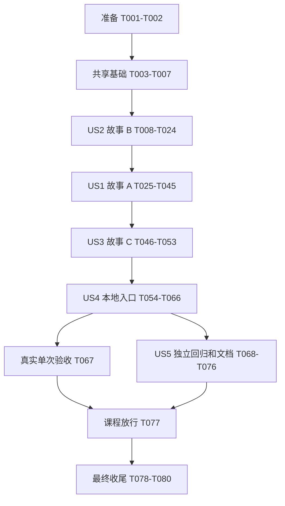

# 任务清单：Provider 课程对齐与补齐验收

**功能**：005-provider-course-alignment | **生成日期**：2026-10-22

**输入**：[规格](spec.md)、[计划](plan.md)、[研究](research.md)、[数据模型](data-model.md)、[配置契约](contracts/profile-config.md)、[调用契约](contracts/provider-api.md)、[审计契约](contracts/audit-storage.md)、[验收契约](contracts/acceptance-harness.md)、[验证指南](quickstart.md)及[宪法](../../.specify/memory/constitution.md)。

**当前状态**：本地实施/回归及quality/secrets/dependencies已通过，当前80/80项完成；真实DeepSeek单次验收、最终只读复核与秘密扫描均通过，课程补齐验收已放行；详细当前证据见validation.md。任务 ID 只在本功能内使用，不覆盖 specs/002-provider-abstraction 的原 51 项任务和验证历史。

## 格式、故事映射与执行约束

每项为 `- [ ] Tnnn [P?] [USn?] 动作及文件路径`。路径相对于仓库根；新增路径代表未来实现位置，不表示当前已有文件。`[P]` 仅表示同一测试/工作波次内文件不冲突、前置条件完成后可并行，不授权跳过阶段门槛或自动启动其他 agent。

| 清单标签 | 对应规格故事 | 优先级 | 任务范围 | 独立验收 |
| --- | --- | --- | --- | --- |
| US1 | US-A：用配置定义 Agent 的模型选择 | P1 | T025～T045，21 项 | 临时目录、双 HTTP stub、启动快照、真实临时 SQLite；A-01～A-06 |
| US2 | US-B：按会话追溯每次模型调用 | P1 | T008～T024，17 项 | 不依赖 Profile 加载，直接调用检验两会话、重试、V2/旧库及审计故障；B-01～B-06 |
| US3 | US-C：完整传递工具说明且绝不执行 | P1 | T046～T053，8 项 | 最终请求 JSON、递归拒绝、返回意图和零执行；C-01～C-03 |
| US4 | US-D：用显式冒烟证明真实模型可连通 | P1 | T054～T067，14 项 | 默认零外呼及本地负例；另以一次真实发送/响应/审计验收 D-02；D-01～D-03 |
| US5 | US-E：保留既有能力并可审查交付 | P1 | T068～T077，10 项 | 原测试与新增回归、中文注释、追溯、安全门禁和历史保护；E-01～E-02 |

US1～US5 是本文件为技能格式采用的局部标签，不是项目原 US-1～US-5。五故事同为 P1，按计划的技术依赖先执行 US2，再执行 US1、US3、US4、US5。

测试为规格 FR-020 和宪法强制要求。各故事先写测试并观察预期失败，再实现再通过；新 API 可先建立编译所需的最小签名骨架，但失败证据必须指向行为缺口，不能以编译/下载失败、零发现或跳过替代。旧有正确行为的回归测试不要求人为破坏后变红。每故事保存聚焦测试与完整 `mvn test`、`mvn clean package` 结果后，才能进入依赖它的故事。

全部新增/修改关键代码和测试有详细中文注释；配置/夹具/示例采用 YAML。Java 21、九模块、Boot 4.1.1、Spring AI 2.0.1 和已批准安全依赖覆盖保持。不得实现本轮排除的 ReAct、Memory、工具执行、通知、调度或会话存储；不得额外引入自动回退、竞速、熔断或 SDK 重发。

## 阶段一：准备与保护已有工作

**目的**：识别当前工作区与历史证据，复用现有工程，不重新初始化模块。

- [X] T001 在 specs/005-provider-course-alignment/validation.md 建立本轮独立证据记录，登记活动功能和实际分支、当前修改及基线指纹；保护 specs/002-provider-abstraction/tasks.md、specs/002-provider-abstraction/validation.md、aegisos-storage/src/main/resources/db/schema/sqlite/V001__llm_calls.sql 和旧测试清单；FR-023，初始各场景标 NOT_RUN，不保存敏感内容。
- [X] T002 对 pom.xml、aegisos-boot/pom.xml 和 scripts/check.sh 核对九模块/Java 21/Boot 4.1.1/Spring AI 2.0.1/安全覆盖及实际命令，执行 `mvn -version`、`mvn test`、`mvn clean package`，将当前基线而非历史 91 项的实际统计、失败和退出码写入 specs/005-provider-course-alignment/validation.md；基线失败先定位，不删除测试或改原任务通过状态。

## 阶段二：共享测试基础（阻断前置）

**目的**：建立后续故事复用的隔离夹具和兼容性检查，不提前实现故事业务。

- [X] T003 [P] 新增 aegisos-boot/src/test/java/com/aegisos/boot/config/CourseAlignmentFixtures.java，提供临时工作区、独立 SQLite 路径、合成环境供应器、loopback 双 Provider 配置及安全报告辅助；不读取个人 .aegisos，不默认使用真实凭据或真实网络，不依赖尚未交付的 Profile 业务类型。
- [X] T004 [P] 扩充 aegisos-provider/src/test/java/com/aegisos/provider/support/HttpStub.java 的本地请求计数、请求 JSON 捕获和可控响应/失败能力，保留已有夹具调用兼容；捕获仅用于测试内存，不输出正文/头，不把 stub 计数称为真实厂商发送证据。
- [X] T005 [P] 新增 aegisos-storage/src/test/java/com/aegisos/storage/audit/AuditMigrationFixture.java，复用原 V001 生成四状态、未知历史错误和 nullable/64 位用量合成数据，提供逐行原列比较、独立连接/重开读取及故障注入辅助；不更改 V001，不操作用户实际数据库。
- [X] T006 扩充 aegisos-core/src/test/java/com/aegisos/core/provider/ProviderContractTest.java 的原 ModelRequest 五字段和原审计构造方式兼容检查，明确 core 无 Spring AI/JPA/YAML 实现依赖；作为以后新增入口/字段的回归契约保留，不重编号原测试。
- [X] T007 验证 T003～T006 的夹具与兼容检查能被实际发现，执行 `mvn test`、`mvn clean package` 并在 specs/005-provider-course-alignment/validation.md 保存结果；确认默认无真实外呼、旧测试未被禁用后开放故事阶段。

## 阶段三：US2 / 故事 B——会话审计、兼容字段和手工迁移（P1，首个增量）

**目标**：直接 Provider 调用可按会话/请求/尝试追溯，V2 状态列一致，原库能安全手工升级，不依赖 Agent/ReAct。

**独立验收**：真实临时 SQLite 加本地模型替身覆盖 B-01～B-06；新入口拒绝非法身份且不发送，旧入口明确未关联，前置审计必须提交，终态故障停止重试。完成 T024 才可开始依赖它的 US1。

### 先编写并运行失败测试

- [X] T008 [P] [US2] 新增 aegisos-core/src/test/java/com/aegisos/core/provider/SessionAssociationTest.java，覆盖 sessionId「1～64 个 ASCII 字符；`[A-Za-z0-9][A-Za-z0-9_-]{0,63}`；区分大小写，不 trim」、两种入口模式、null/空白/超长/非法字符、合法未知会话及旧入口空关联，检查安全异常不回显原值；B-06，FR-008。
- [X] T009 [P] [US2] 扩充 aegisos-storage/src/test/java/com/aegisos/storage/audit/JpaLlmCallAuditStoreTest.java，先断言三列真实存在、四状态映射、独立连接可见/重开、重复 complete 拒绝和未知用量 null，并用直接 SQL 验证 STARTED+false、SUCCEEDED+null、FAILED+null/空说明等 CHECK 反例；B-03，FR-010。
- [X] T010 [P] [US2] 新增 aegisos-storage/src/test/java/com/aegisos/storage/audit/AuditSchemaMigrationTest.java，读取同一手工 SQL 资源验证 V001 四状态迁移、原列逐行等值、历史 session null、未知错误安全回填、大整数用量、重开新写、重复执行非零/无修改、未知版本/无版本非空/缺列/自定义索引或 trigger 拒绝及复制失败回滚；B-04，FR-011。
- [X] T011 [P] [US2] 扩充 aegisos-provider/src/test/java/com/aegisos/provider/service/ProviderRetryTest.java、aegisos-provider/src/test/java/com/aegisos/provider/service/ProviderAuditFailureTest.java 和 aegisos-storage/src/test/java/com/aegisos/storage/audit/AuditStorageFailureTest.java，覆盖同关联先超时再成功、maxRetries=2 最多 3 次/默认 1 次、各次 begin 提交失败零新增发送、complete 失败 UNKNOWN/停止重试、锁/不可写/提交错误及此前调用事实保留；B-02、B-05。
- [X] T012 [P] [US2] 新增 aegisos-boot/src/test/java/com/aegisos/boot/config/ProviderSessionTest.java，直接调用新/旧入口并存读真实 SQLite：两会话、同会话多请求不同 requestId、各次尝试关联一致无覆盖、合法未知会话接受且无会话查表、非法原值不落库、新入口 null 不回退；B-01、B-02、B-06，FR-008、FR-009。

### 模型、存储和服务

- [X] T013 [US2] 新增 aegisos-core/src/main/java/com/aegisos/core/provider/SessionAssociation.java 并扩充同目录 ProviderErrorCode.java，按 T008 的原文约束实现 LEGACY_UNASSOCIATED/SESSION_REQUIRED 显式模式及 SESSION_REQUIRED/INVALID_SESSION_ID 安全代码；「格式合法但无会话记录：接受为追踪值，不查表，不视为已认证或会话已存在」，不得将标识放入 SDK 消息或 toString。
- [X] T014 [US2] 在 aegisos-core/src/main/java/com/aegisos/core/provider/ProviderService.java 增加 `chat(String sessionId, ModelRequest request)`，保留旧入口和五字段 ModelRequest；在 aegisos-core/src/main/java/com/aegisos/core/audit/AuditStart.java、AuditRejection.java 增加可空 sessionId 并保留原参数辅助构造器，旧构造器置 null；LlmCallAuditStore/AuditCompletion 不接受自由错误文本或变更关联。
- [X] T015 [US2] 新增 aegisos-storage/src/main/resources/db/schema/sqlite/V002__llm_calls.sql：session_id「新会话合法值，旧入口/历史/无效身份拒绝为 null；不建会话 FK」，success「仅 null/0/1，必须与 status 一致；不能用 primitive boolean」，error_message「最多 256 字符；固定安全说明，不来自 Throwable 或厂商正文」；保留全部原列、UNIQUE(request_id,attempt_no) 和 request 索引，新增 (session_id,created_at) 索引，CHECK 显式处理 NULL。
- [X] T016 [US2] 新增 aegisos-storage/src/main/resources/db/migration/sqlite/V002__provider_course_audit.sql，按审计契约以纯 SQLite SQL、BEGIN IMMEDIATE、版本/形状/扩展对象前检、临时校验表、复制校验/表替换/索引恢复、最后更新版本后提交实现离线 V1→V2；历史 session 全 null，原字段逐行不变，未知错误说明固定为「历史调用未成功，详细原因不可用」，任一失败回滚，V2 重跑 ALREADY_MIGRATED 非零且无修改，禁止自动修复 STARTED/重放。
- [X] T017 [US2] 修改 aegisos-storage/src/main/java/com/aegisos/storage/audit/AuditSchemaInitializer.java 及 AuditStorageConfiguration.java，真正空库事务初始化完整 V2；合法 V2 校验列/约束/索引；V1 仅安全 MIGRATION_REQUIRED 拒绝且不改库，未知版本/无版本非空/损坏拒绝；失败关闭 DataSource，保持 ddl-auto: none，不在启动时运行迁移脚本，不用简单分号切割手工脚本。
- [X] T018 [US2] 修改 aegisos-storage/src/main/java/com/aegisos/storage/audit/LlmCallEntity.java 和 LlmCallRepository.java，新增 nullable String/Boolean/String 映射，按「STARTED→success 空、SUCCEEDED→true、FAILED/REJECTED→false」及「STARTED/SUCCEEDED 的 error_message 为空，失败/拒绝为安全标准说明」维护字段；「状态仅允许 STARTED→SUCCEEDED/FAILED，REJECTED 直接插入；不能把已有终态再次完成」，complete 条件更新全部终态字段且命中恰好 1 行，关联不可变、未知用量不补零。
- [X] T019 [US2] 修改 aegisos-storage/src/main/java/com/aegisos/storage/audit/JpaLlmCallAuditStore.java 并新增 aegisos-core/src/main/java/com/aegisos/core/audit/SafeAuditErrorMessages.java，集中固定错误类别→安全说明，二次校验字段并保留 begin/complete/reject 独立 REQUIRES_NEW 提交语义；STARTED「终止时间/耗时为空」，SUCCEEDED/FAILED「终止时间/耗时非空」，REJECTED「终止时间非空、耗时 0、不可重试」；不保存 Throwable/正文，不将 save/flush 当提交。
- [X] T020 [US2] 重构 aegisos-provider/src/main/java/com/aegisos/provider/service/DefaultProviderService.java 的新旧入口到单一执行流程：每逻辑请求新 UUID 后校验身份/请求、拒绝审计或 begin→提交→单次调用→complete→有限重试；「外呼从 1 递增；本地拒绝为 0；同请求重试保持 sessionId/requestId 不变」；UNKNOWN 优先，终态审计失败立即停止，旧入口不生成虚假 sessionId。
- [X] T021 [US2] 修改 aegisos-provider/src/main/java/com/aegisos/provider/service/AuditMetadataPolicy.java，将合法关联传入 begin/reject、非法关联置 null，继续仅保存已注册 Provider/允许模型；补全安全分类映射于 aegisos-provider/src/main/java/com/aegisos/provider/service/ProviderErrorClassifier.java，所有本地拒绝外呼为零，拒绝审计失败为 AUDIT_UNAVAILABLE/NOT_SENT，未知输入不反射到数据库或错误。
- [X] T022 [US2] 更新 aegisos-boot/src/test/java/com/aegisos/boot/config/BootProviderFixture.java、ProviderWiringTest.java 和已有受影响 core/provider/storage 测试替身以适配新重载/DTO/V2，保留旧构造方式和原安全断言；将原 V1 特定初始化断言保留为迁移/拒绝测试，不删除或禁用旧场景来适配新版本。
- [X] T023 [US2] 在隔离临时目录对 aegisos-storage/src/main/resources/db/migration/sqlite/V002__provider_course_audit.sql 执行实际 `sqlite3 -bail` 验证与一致性 backup/恢复演练，覆盖成功、重复执行、锁和中途失败；核对 JDBC ScriptUtils 运行同一资源及重开结论，记录命令/统计于 specs/005-provider-course-alignment/validation.md，不迁移个人现有库；缺 CLI 如实 NOT_RUN，不勾选本项。
- [X] T024 [US2] 运行 quickstart.md 的 B 存储/服务聚焦命令，另执行 `mvn -pl aegisos-boot -am -Dtest=ProviderSessionTest -Dsurefire.failIfNoSpecifiedTests=false test`，核对各目标类实际执行，再完整 `mvn test`、`mvn clean package`；在 specs/005-provider-course-alignment/validation.md 记录 B-01～B-06、FR-008～FR-012/FR-018 的本轮证据与 T023 状态，B 未满足不得开始依赖的 A。

## 阶段四：US1 / 故事 A——Profile 全字段、加载与显式路由（P1，配置 MVP）

**目标**：唯一 YAML 来源、目录技能绑定、安全启动索引和 Profile→单一 Provider 调用，运行时使用不变快照。

**独立验收**：只用临时目录/环境供应器、双本地 HTTP stub 和真实临时 SQLite，覆盖 A-01～A-06，不需要 ReAct/通知/技能执行或真实凭据。故事 B 为审计基础；A 的缺模型/坏 Profile 同样安全拒绝。

### 先编写并运行失败测试

- [X] T025 [P] [US1] 新增 aegisos-core/src/test/java/com/aegisos/core/profile/ProfileContractTest.java，覆盖 name/description/identity/provider 的边界、全部集合深度冻结、嵌套 toString 脱敏、可空可选字段与 metadata 树、只读索引不可运行时注册；反例与数据模型原文约束一致，不能只测试 getter；A-01，FR-003。
- [X] T026 [P] [US1] 新增 aegisos-boot/src/test/java/com/aegisos/boot/config/ProfileLoaderTest.java，使用 YAML 夹具覆盖课程全字段/嵌套/默认、未知顶层和固定结构键、YAML skills 禁止、坏文件隔离、同名全部剔除、未知 Provider/越界模型、已注册但缺凭据可承载元数据、缺文件不读 frontmatter、空/缺根及安全诊断；增加过大/过深/节点/列表/标签/别名/重复键/多文档等反例；A-01、A-02。
- [X] T027 [P] [US1] 新增 aegisos-boot/src/test/java/com/aegisos/boot/config/ProfilePathSafetyTest.java，覆盖工作区/Agent/profile.yml/skills 容器/公共根 realpath 边界、合法相对绑定排序、绝对/悬空/循环/越界/普通文件拒绝和不读取 SKILL.md/bootstrap/脚本正文；A-01、A-02，FR-001～FR-003。
- [X] T028 [P] [US1] 新增 aegisos-boot/src/test/java/com/aegisos/boot/config/ProfileEnvironmentTest.java，覆盖仅 provider.name/model/temperature 的全值 ${ENV_NAME} 存在/缺失/空/非法/有限数值边界，拒绝嵌入/默认值/递归占位，其他字段只保留字面文本；用合成秘密哨兵验证环境值/解析异常不泄漏；A-03，FR-005、FR-019。
- [X] T029 [P] [US1] 新增 aegisos-boot/src/test/java/com/aegisos/boot/config/ProfileSnapshotTest.java，以可替换环境供应器/两个独立启动上下文覆盖修改/新增/删除 Profile、连接和凭据，旧 context 不变、重启才生效，同请求及重试共享快照；不通过修改 JVM 真实环境或调用真实模型测试；A-05，FR-006。
- [X] T030 [P] [US1] 新增 aegisos-boot/src/test/java/com/aegisos/boot/config/ProfileRoutingTest.java，覆盖按名组装 Profile→指定 Provider/允许模型/可选温度的双 stub 线上 JSON、调用方无法覆盖选择、Profile.tools 子集、缺/未知 Profile 或选择无效的零外呼和 REJECTED、查找前已生成 requestId、单 bean 双接口；A-04，FR-004、FR-008。
- [X] T031 [P] [US1] 新增 aegisos-boot/src/test/java/com/aegisos/boot/config/ApplicationYamlCompatibilityTest.java，比较默认/dev/metrics/provider-test 的有效配置和环境差异、凭据引用/日志安全绑定、无同名旧 properties 资源覆盖；只装配必要组件和本地替身，不探测模型或重复整套 YAML 迁移；A-06，FR-007。

### 领域类型、安全加载与装配

- [X] T032 [US1] 新增 aegisos-core/src/main/java/com/aegisos/core/profile/Profile.java 及同包 Identity.java、ProviderSelection.java：name「必填；`[A-Za-z0-9][A-Za-z0-9_-]{0,63}`；不 trim；可与目录名不同，以便检测跨目录重名」，description「可省略；最多 4096 字符；不展开环境变量」，identity「agent_name、prompt 可选字符串；prompt 最多 65536 字符；仅保留元数据，不读取其引用文件或拼接模型消息」，provider「name/model 明确，按现有安全标识规则及全局允许集合校验；temperature 可空、有限数值 [0,2]」；深度不可变和脱敏 toString，无框架依赖。
- [X] T033 [US1] 在 aegisos-core/src/main/java/com/aegisos/core/profile/ 新增 MetadataValue.java、SkillBinding.java、ChannelMetadata.java、ScheduleMetadata.java、Settings.java 并补齐 Profile：tools「可省略为空；唯一 Tool 名称，遵守现有 ToolSchema 名称格式；只限制可传递的 schema 名称，不执行工具」，skills「仅合法相对软连接派生，按本地绑定名排序；YAML 出现 skills 即配置错误」，mcp_servers「可省略为空；唯一、安全名称引用；不连接 MCP，不查询注册表」，channels「name 必填且唯一；config 为受限不可变元数据映射，可省略为空；不建立 Channel」，notify_channels「可省略为空；唯一通知名称引用；不解析数据库注册表、不保存 URL/凭据」，schedules「key、cron、zone、message 必填；display_name 可选；key 唯一，zone 可由 ZoneId 解析，cron/message 非空；仅结构校验，不注册调度」，bootstrap「可省略为空；只保存相对文件名；拒绝绝对路径及 .. 片段；不读取/执行文件」，settings「max_iterations、max_history_turns 可空正整数；其余受限元数据保留；不在本轮赋予 ReAct 行为」；MetadataValue「每列表最多 256 项，总节点最多 4096，深度最多 32」，仅字符串键和有界标量/列表/映射，拒绝日期/二进制/对象、敏感字段承载值，不静默删字段。
- [X] T034 [US1] 新增 aegisos-core/src/main/java/com/aegisos/core/profile/ProfileRegistry.java、ProfileLoadReport.java、ProfileDiagnostic.java，构建只读深度不可变索引/结果；「来源仅安全相对路径，非法路径名替换为固定占位，行/列可选。不携带 Throwable/解析树/环境值」，同名候选全部无效且已取得安全名称的非法候选参与冲突检查，不公开 register/remove；缺根为空、越界根拒绝、不按扫描顺序覆盖。
- [X] T035 [US1] 新增 aegisos-core/src/main/java/com/aegisos/core/provider/ProfilePrompt.java 和 ProfileProviderService.java，定义 `chatProfile(String sessionId, String profileName, ProfilePrompt prompt)`；ProfilePrompt「不可变的 messages、toolSchemas、可空 maxOutputTokens」，传入 schema 名必须为 Profile.tools 子集、未提供不补齐，保留原消息/正输出上限校验；ProviderErrorCode.java 增 PROFILE_REQUIRED/UNKNOWN_PROFILE，不接受 Provider/模型/温度覆盖，不引用 Spring AI Prompt。
- [X] T036 [US1] 在 aegisos-boot/pom.xml 显式声明 BOM 管理的 SnakeYAML 2.6，不改 Boot/Spring AI/安全覆盖、不增加模块或新 starter；核对领域模块不引入 YAML，实现依赖只用于 boot 安全加载。
- [X] T037 [US1] 新增 aegisos-boot/src/main/java/com/aegisos/boot/config/SafeProfileYamlReader.java，落实「单文件读取上限 262144 字节/codepoints，限制在读入完整字符串之前生效；最大嵌套 32、节点 4096、列表 256」；SafeConstructor 配合事件/节点层拒绝重复/递归 key、anchor/alias/merge、危险标签、非字符串键、多文档及非映射根，拒绝时间/集合/二进制/对象；诊断不得传播原 YAML 异常、片段或键值。
- [X] T038 [US1] 新增 aegisos-boot/src/main/java/com/aegisos/boot/config/ProfilePathPolicy.java，按配置契约冻结工作区根，仅扫描 .aegisos/agents 直接子目录精确 profile.yml，校验所有容器 realpath；SkillBinding 保存安全本地名/相对绑定与目标路径，仅接受真实公共 .aegisos/skills 内存在目录的相对软连接；拒绝绝对/悬空/循环/越界/普通文件，不读取正文，不声明 OS/多租户沙箱保证。
- [X] T039 [US1] 新增 aegisos-boot/src/main/java/com/aegisos/boot/config/ProfileFieldMapper.java，按 T032～T033 原文约束逐字段严格映射，固定结构未知键及 YAML skills 拒绝，元数据扩展只限 channels.config/settings，检查敏感键和引用名；校验 Provider 存在/模型获准，缺凭据可注册元数据但不视为可调用，不触发技能/MCP/通知/调度/bootstrap 行为。
- [X] T040 [US1] 新增 aegisos-boot/src/main/java/com/aegisos/boot/config/ProfileEnvironmentResolver.java，仅在启动时解析 provider.name/model/temperature 的全值占位，变量名 `[A-Za-z_][A-Za-z0-9_]*`，缺失/空/非法使该 Profile 无效且不输出值；保留全局 credential-ref: env:NAME，不读取其他字段占位或把凭据放入 Profile。
- [X] T041 [US1] 新增 aegisos-boot/src/main/java/com/aegisos/boot/config/ProfileLoader.java，组合 T037～T040 两阶段解析/分组/注册，坏文件与重名条目隔离、其他合法继续可查；缺/空目录安全提示，不从 AGENT.md 或 profiles 第二来源回退；全局 Provider 重名仍拒绝启动；只输出固定类别/安全来源/行列，不逐请求读盘或动态变更索引。
- [X] T042 [US1] 扩充 aegisos-provider/src/main/java/com/aegisos/provider/service/DefaultProviderService.java 实现 ProfileProviderService 并注入 core ProfileRegistry，保留旧构造器委托空索引；在已生成 requestId 的共用校验边界内查 Profile/校验工具子集并构造原 ModelRequest，PROFILE_REQUIRED/UNKNOWN_PROFILE/工具越界均走拒绝审计，不在外层未审计抛错，不默认模型、不自动拼接身份/技能正文。
- [X] T043 [US1] 新增 aegisos-boot/src/main/java/com/aegisos/boot/config/ProfileConfiguration.java 并修改 ProviderConfiguration.java，在全局 Provider 快照后加载只读 ProfileRegistry，providerService 暴露同一具体实现 bean 供两接口注入，避免循环依赖/多套重试；只在启动/重启生效，装配无探测/注册调度/连接 MCP。
- [X] T044 [US1] 在 aegisos-boot/src/main/resources/application.yml、application-dev.yml、application-metrics.yml 和 aegisos-boot/src/test/resources/application-provider-test.yml 验证并补齐必要 YAML 配置/中文注释，新增 aegisos-boot/src/test/resources/profile-fixtures/ 下合法/非法 YAML；无实际凭据，无同名旧 properties 覆盖；不重复并行基线已完成的迁移、不把遗留 target 文件当源码事实。
- [X] T045 [US1] 运行 quickstart.md 的 A/B 集成聚焦命令并补跑 ProfileContractTest，核对各类实际发现，完整 `mvn test`、`mvn clean package`；将 A-01～A-06、FR-001～FR-007、SC-001/SC-002/SC-010、技能/通知批准替代与零执行证据写入 specs/005-provider-course-alignment/validation.md，未满足不得进入依赖的真实冒烟。

## 阶段五：US3 / 故事 C——schema 全字段与零工具执行（P1）

**目标**：公开支持子集、递归校验，最终 JSON 语义不丢失；模型意图返回上层，Provider 没有执行/下一轮副作用。

**独立验收**：本地 HTTP stub 捕获最终 JSON，复杂 schema 语义树一致、非法 schema 零发送且审计拒绝；纯/混合意图执行次数零、HTTP 仅一次。此故事可不依赖 Profile 使用直接入口验收，但按清单串行推进以避免同文件竞争。

### 先编写并运行失败测试

- [X] T046 [P] [US3] 新增 aegisos-provider/src/test/java/com/aegisos/provider/adapter/ToolSchemaContractTest.java 的 C-01 正例，逐项核对最终 HTTP tools[].function 的 name/description/parameters：各层类型/说明、properties、required、嵌套对象、items、enum、additionalProperties 和缺省不补值，比较完整语义树且数组顺序保留；FR-013、SC-005。
- [X] T047 [US3] 在 T046 的 aegisos-provider/src/test/java/com/aegisos/provider/adapter/ToolSchemaContractTest.java 增 C-02 反例：重复 JSON 键/超限、根非 object、type 数组、嵌套 $ref、非法 required/items/enum、未知约束/关键字；断言 UNSUPPORTED_TOOL_SCHEMA、HTTP=0、无静默删字段；同文件与 T046 串行。
- [X] T048 [P] [US3] 扩充 aegisos-provider/src/test/java/com/aegisos/provider/adapter/OpenAiCompatibleAdapterTest.java，C-03 同时覆盖纯 ToolCall、文本加多个意图、id/name/arguments/顺序、空响应协议错误，断言工具执行=0、HTTP=1、无下一轮；反例确认配置不能启用执行，不引入真工具或 Sandbox 执行体。
- [X] T049 [P] [US3] 扩充 aegisos-provider/src/test/java/com/aegisos/provider/service/ProviderServiceTest.java，验证支持/不支持 schema 经统一校验边界产生正确成功/拒绝审计、零发送与安全错误，不因适配层校验把拒绝记为已外呼失败；关联标识/原始 schema 不反射到错误信息；C-02，FR-012～FR-014。

### 适配与验证

- [X] T050 [US3] 新增 aegisos-provider/src/main/java/com/aegisos/provider/adapter/ToolSchemaValidator.java，按调用契约递归实现支持子集和「参数 JSON 最多 256 KiB、深度 32、节点 4096」；根 object、单一 type、同层 required 唯一且属于 properties、数组单 items、符合标量 type 的非空无重 enum、boolean additionalProperties；未列关键字全部拒绝，失败只有安全错误码。
- [X] T051 [US3] 修改 aegisos-provider/src/main/java/com/aegisos/provider/adapter/OpenAiMessageMapper.java，将 T050 接入外呼前校验并显式 strict(false)，保留 schema 原始语义、不扩 required/additionalProperties，描述缺省仍为空字符串；保留直接 model.call/不可执行 SchemaDescriptor.call，不装配 Advisor，不调用 Spring AI 2.0.1 不存在的自动执行开关；详细注释解释版本差异和边界。
- [X] T052 [US3] 核对 aegisos-provider/src/main/java/com/aegisos/provider/adapter/OpenAiCompatibleAdapter.java、OpenAiClientFactory.java 和 aegisos-boot/src/test/java/com/aegisos/boot/config/ProviderSecurityTest.java，运行 T048～T049 及原安全测试，确认所有选项仍无法执行工具或隐藏重发；若现有实现已满足则保留，不为勾任务引入无意义改动，证据写 specs/005-provider-course-alignment/validation.md。
- [X] T053 [US3] 运行 quickstart.md 的 C 聚焦命令并补跑 ProviderServiceTest、ProviderSecurityTest，确认目标用例发现，执行 `mvn test`、`mvn clean package`；在 specs/005-provider-course-alignment/validation.md 登记 C-01～C-03、FR-013/FR-014、SC-005 的实际字段断言/零执行/零第二轮统计。

## 阶段六：US4 / 故事 D——独立真实冒烟与不误报（P1）

**目标**：默认启动/构建/CI 零真实外呼；显式启用才执行 DeepSeek 单次测试，报告统计、响应和持久审计都满足才能 PASS。

**独立验收**：本地测试证明 D-01/D-03；D-02 必须真实执行一次。T066 只完成本地入口门槛，T067 不通过则 US4 仍未完成，不能用本地 stub 或打包代替。

### 先编写并运行本地失败测试

- [X] T054 [P] [US4] 新增 aegisos-boot/src/test/java/com/aegisos/boot/config/DefaultProviderIsolationTest.java，用合成非空凭据及禁止非 loopback 发送的可观察夹具，覆盖默认启动/测试/打包配置零真实外呼、Surefire 默认发现不含 IT、默认有效 POM/engineering CI 未启用冒烟 profile；不能靠缺 key 或扫描类名推断无外呼；D-01，FR-015。
- [X] T055 [P] [US4] 新增 aegisos-boot/src/test/java/com/aegisos/boot/config/ProviderSmokeEvidenceTest.java，以本地配置/报告夹具覆盖未启用、缺 YAML/标识/凭据、零发现/跳过、旧报告、网络/认证/响应/审计不匹配的分类及安全错误，无真实发送；断言缺条件 NOT_RUN、实际失败 FAIL、两者非成功；D-03，FR-017。
- [X] T056 [P] [US4] 新增 aegisos-provider/src/test/java/com/aegisos/provider/adapter/SingleRequestHttpClientTest.java，以实际 loopback 交换验证传输观察器每次物理 HTTP 发送尝试计数，覆盖成功、503/Retry-After、重定向、连接/读取故障及 SDK 零重发；不把 adapter 次数/审计行数当 HTTP 实发数、不记录 URL/头/正文；D-02、FR-018。
- [X] T057 [P] [US4] 新增 scripts/tests/test_verify_provider_smoke.py 的标准库合成报告测试，覆盖唯一目标类/唯一测试、发现/执行/跳过/错误计数、缺/坏/陈旧 XML/JSON、runId/时间不一致、Maven 失败不可转 PASS、预检 NOT_RUN、真实断言 FAIL 和秘密哨兵零输出；用 `python3 -m unittest discover -s scripts/tests -p test_verify_provider_smoke.py` 观察预期失败。
- [X] T058 [US4] 新增 aegisos-boot/src/test/java/com/aegisos/boot/provider/ProviderSmokeIT.java，固定一个 @Test、real-provider 标签及显式启用门禁，定义非空文本/单次发送/重开审计的失败断言，不用 Assumptions；此时只运行本地预检夹具，不真实调用，默认 Surefire 不发现 IT；D-02/D-03 的真实执行留到 T067。

### 入口、观察与证据

- [X] T059 [US4] 新增 aegisos-provider/src/main/java/com/aegisos/provider/adapter/TransportSendObserver.java 并接入 SingleRequestHttpClient.java、OpenAiClientFactory.java、OpenAiCompatibleAdapter.java 的兼容构造/装配，在实际 OkHttp 网络交换点仅暴露计数；默认 NOOP，不记录 URL/认证/正文，不改变重试/重定向/超时/资源关闭；使 T056 可验证且冒烟能读取本次计数。
- [X] T060 [US4] 仅在 aegisos-boot/pom.xml 新增默认不激活的 real-provider-smoke profile：Failsafe 3.5.2 绑定 integration-test/verify，includes=**/ProviderSmokeIT.java、groups=real-provider、failIfNoTests=true、failIfNoSpecifiedTests=true，向 fork 传布尔启用标记；不把 key 转 JVM 属性，不在 root 全局施加零测试门槛、不放宽真实发现失败。
- [X] T061 [US4] 新增 aegisos-boot/src/test/resources/application-provider-smoke.yml 和 aegisos-boot/src/test/resources/provider-smoke/agents/course-smoke/profile.yml，使用 deepseek-main/显式 deepseek-flash、env:DEEPSEEK_API_KEY、max-retries=0、明确超时及 smoke.profile-name/session-id，Profile 无 tools/temperature、请求无 maxOutputTokens；仅通过 AEGISOS_SMOKE_CONFIG 显式读取专用 YAML，默认不得加载/连接。
- [X] T062 [US4] 新增 aegisos-boot/src/test/java/com/aegisos/boot/provider/ProviderSmokeFixture.java，复用生产 ProviderConfiguration/AuditStorageConfiguration/ProfileConfiguration 最小装配和临时工作区/SQLite；预检配置/标识/凭据/零重试，缺条件安全 NOT_RUN 失败退出，不打印值或查会话；真实模式不得把 Provider 换成 stub，不启动 Web/通知/调度。
- [X] T063 [US4] 实现 scripts/verify-provider-smoke.py，仅解析本次 Failsafe XML 和安全 JSON，核对目标类发现=1/执行=1/skipped=0/failures=0/errors=0、runId/时间、传输发送=1/非空响应/重开审计布尔；PASS 才返回 0，NOT_RUN/FAIL 非零，Maven 失败不能被改成功；不读环境/凭据/数据库、不输出原异常，按 T057 验证缺/陈旧/矛盾证据分类。
- [X] T064 [US4] 完成 aegisos-boot/src/test/java/com/aegisos/boot/provider/ProviderSmokeIT.java 的一次 chatProfile(sessionId, profileName, prompt) 和 finally 安全证据写入 aegisos-boot/target/provider-smoke-result.json：发送尝试=1、文本非空、临时库新增 1 行、session/request 对应、attempt_no=1、status=SUCCEEDED/success=true/error_code与error_message均null、重开成立；保留可空用量，证据仅固定身份/安全计数/布尔/requestId/runId/时间及无秘密配置指纹，不输出完整文本或密钥摘要。
- [X] T065 [US4] 验证 aegisos-boot/pom.xml 和 scripts/verify-provider-smoke.py 的真实发现/失败入口：在清理过且已移除 DEEPSEEK_API_KEY/AEGISOS_SMOKE_CONFIG 的独立子进程环境执行显式 profile，只允许预检 NOT_RUN、零外呼、非零；另以合成报告验证零发现/跳过/旧报告，不为制造零测试临时删除真实源码；保存两次命令退出码与本次报告于 specs/005-provider-course-alignment/validation.md。
- [X] T066 [US4] 运行 quickstart.md 的 D 本地聚焦命令、T056/T057，核对 boot 默认/启用 profile 的 effective POM 与默认 CI 入口，然后 `mvn test`、`mvn clean package`；在 specs/005-provider-course-alignment/validation.md 记录 D-01/D-03 与真实 D-02 仍 NOT_RUN，不让存在凭据触发真实运行，完成 A/B/C 及此门槛后才允许 T067。
- [X] T067 [US4] 仅在本轮已有明确真实调用授权、可用 YAML/DeepSeek 凭据与前置门槛全部满足时，按 specs/005-provider-course-alignment/quickstart.md 执行 `mvn -pl aegisos-boot -am -Preal-provider-smoke -Dit.test=ProviderSmokeIT clean verify` 和独立报告核验；保持既有 /v1、无工具/无温度/无输出 token 参数/禁重试，说明短提示和超时并非硬计费上限；实际一次成功响应/发送/审计才勾选，失败不换路径/模型补跑，缺条件则 NOT_RUN 保留未勾选并继续不依赖真实成功的工作，结果写 specs/005-provider-course-alignment/validation.md；D-02，FR-016/FR-017。

## 阶段七：US5 / 故事 E——回归、安全门禁与可追溯交付（P1）

**目标**：原 Provider 安全契约持续有效，7 条课程要求有本轮证据，代码/配置可接手，历史不被覆盖。

**独立验收**：原测试及新增行为、中文注释、YAML、实际门禁与原文件指纹均可审查；D-02 若未成功，先完成独立回归/文档，但不得勾选最终课程放行任务。

- [X] T068 [US5] 扩充 aegisos-boot/src/test/java/com/aegisos/boot/config/ProviderSecurityTest.java，在已有原 US-1 测试上增加 Profile/YAML 解析/非法关联/审计说明/冒烟异常跨边界的合成秘密哨兵断言；先运行暴露本轮遗漏的失败测试，再在对应实现点修复，确认配置、异常、日志、审计、报告无明文，不读取真实 key；E-01，FR-019、SC-010。
- [X] T069 [US5] 按 FR-022 人工审查并补齐 aegisos-core/src/main/java/com/aegisos/core/profile/Profile.java、core/provider/ProviderService.java、aegisos-provider/src/main/java/com/aegisos/provider/service/DefaultProviderService.java、aegisos-boot/src/main/java/com/aegisos/boot/config/ProfileLoader.java、aegisos-storage/src/main/java/com/aegisos/storage/audit/JpaLlmCallAuditStore.java 及本轮其余公共/复杂路径的详细中文注释：参数/返回/错误、来源/重启、路径/安全、提交与重试、迁移/兼容/冒烟；测试注释说明边界，不把未实现能力写成已交付，记录审查范围于 specs/005-provider-course-alignment/validation.md。
- [X] T070 [P] [US5] 同步 AGENT.md 和 README.md 的已批准入口、profile.yml 唯一来源、skills 目录/通知引用、启动快照、旧入口未关联和真实冒烟状态；沿用现有开源 README 结构及 SVG 图片，不重做 logo/无关内容，不把课程模型公开文档当连通证据；E-02，FR-007/FR-021～FR-023。
- [X] T071 [P] [US5] 同步 docs/DemandAnalysis.md、docs/TechnicalSolution.md、docs/AiProgrammingGuide.md 及 docs/Provider课程补齐与验收流程.md 中本轮涉及的 frontmatter/热更新/字段/会话/审计/测试发现描述，明确本功能批准替代与未来设计；实际技术基线/九模块不变，课程转录原文和图片不改，不扩展其他功能范围；E-02。
- [X] T072 [US5] 汇总 specs/005-provider-course-alignment/validation.md 的 PDF 页码/7 条目→FR/SC→20 场景→本清单任务→实际测试/命令/时间/统计/安全证据，标明目录技能/通知引用/框架 API/会话追踪的批准适配；将缺条件、零测试、跳过及真实未执行分别写 NOT_RUN/FAIL，原 91 项/NVD 结果仅历史引用；E-02，FR-021。
- [X] T073 [US5] 执行 scripts/check.sh 的 `bash scripts/check.sh quality`，保留现有静态检查/格式/测试/打包能力及默认零真实外呼，核对适用报告和命令退出码，将新质量结果写入 specs/005-provider-course-alignment/validation.md；失败不得放宽规则、隐藏测试或借旧报告放行；E-01，FR-020。
- [X] T074 [US5] 执行 scripts/check.sh 的 `bash scripts/check.sh secrets`，验证工作区和 Git 历史扫描实际完成及报告脱敏，检查本轮 YAML/注释/XML/JSON/构建产物无秘密；缺工具或扫描失败如实不通过，不写入或显示真实凭据，记录安全结论于 specs/005-provider-course-alignment/validation.md；E-01，FR-019/FR-020。
- [X] T075 [US5] 核对 scripts/check.sh 的依赖入口及已有受控凭据注入方式；若使用 .tools/us1-evidence/scan_with_keychain.py，先确认脚本存在且只对子进程注入，再实际执行 `bash scripts/check.sh dependencies` 对应门禁；保留安全覆盖，漏洞库/扫描失败仍不通过，模型凭据和 NVD 凭据不混用、不写到参数/文件；将本轮时间/报告/实际结果写 specs/005-provider-course-alignment/validation.md，不借原 T051 状态放行。
- [X] T076 [US5] 对照 T001 保护清单核对 specs/002-provider-abstraction/tasks.md、validation.md 和 aegisos-storage/src/main/resources/db/schema/sqlite/V001__llm_calls.sql 未覆盖，原测试未删除/禁用；完整执行 `mvn test`、`mvn clean package` 并核对九模块/原测试与新增测试实际执行，记录 E-01、本轮与历史区别及默认零外呼于 specs/005-provider-course-alignment/validation.md。
- [X] T077 [US5] 逐项检查 specs/005-provider-course-alignment/validation.md 的 E-01/E-02、7 条目/23 FR/10 SC/20 场景与各故事构建/安全门禁；仅当 T067 真实通过且所有必需项有当前 PASS 证据才勾选课程放行；D-02 或其他项 FAIL/NOT_RUN 时保留本项未完成，列出实际缺口，不发布“课程全部验收通过”。

## 阶段八：收尾与跨故事检查

**目的**：使运行指南、实际交付及任务状态一致，不追加新功能。

- [X] T078 校验并按实际交付同步 specs/005-provider-course-alignment/quickstart.md 与 contracts/acceptance-harness.md 的类名/路径/命令/发现规则，复核相关 YAML 样例、迁移/恢复和冒烟负例可按指南复现；若发现需改变批准契约，先列明确差异走 analyze/修订流程，不在实现中静默选边或改课程原文。
- [X] T079 审查 pom.xml、aegisos-boot/pom.xml、.github/workflows/engineering.yml 与 Git diff/status，核对九模块/Java/依赖基线/默认 CI 无真实外呼；区分本功能代码/文档、已有并行修改与历史 tracked target 产物，在 specs/005-provider-course-alignment/validation.md 记录交付范围，不擅自删除、重置或提交无关工作。
- [X] T080 对照 specs/005-provider-course-alignment/tasks.md、spec.md、plan.md 和 validation.md 做最终一致性复核，复查格式/链接/编号/任务证据，真实失败/未执行不得勾选；运行 `$speckit-analyze` 或实施后的 `$speckit-converge` 记录尚未完成的要求，保留原 US-1 历史，不自动进入项目 US-2 或宣称部署/业务验收。

## 依赖图与顺序

E 的记录从 T001 和每故事门槛开始持续补充；T068～T076 不依赖真实调用成功，可以在缺真实条件时完成。T077 依赖 T067 和全部适用门槛；T078～T080 的文档/范围检查可以先做，最终“课程完成”结论必须等 T077。不得因为默认链路完成而跳过真实任务。

### 任务内关键依赖

| 波次 | 前置 | 可并行 / 串行关系 |
| --- | --- | --- |
| 共享夹具 | T002 通过 | T003、T004、T005 文件分离，可并行；T006 后由 T007 汇合 |
| B 测试 | T007 | T008～T012 各组文件分离，可并行；T013～T022 实现按编号串行；T023/T024 汇总 |
| A 测试 | T024 | T025～T031 可并行；T032～T035 领域结构先于加载/服务；T036 先于 T037；T037～T040 先于 T041；T041/T042 先于 T043；T045 汇合 |
| C 测试 | T045（清单顺序） | T046、T048、T049 可并行，T047 与 T046 同文件须串行；T050→T051→T052→T053 |
| D 本地测试 | T053 | T054～T057 文件分离，可并行；T058 定义真实断言但不真实运行；T059～T064 串行，T065→T066 后才能 T067 |
| E 文档 | T069，且相关实现已稳定 | T070 与 T071 文件分离可并行；质量/秘密/依赖门禁顺序执行，避免多次 Maven 改写同一 target；T077 等待真实证据 |

共享文件 DefaultProviderService.java、ProviderConfiguration.java、boot/pom.xml、各任务阶段写入的 validation.md 不并行修改。同一 reactor/target 的构建、格式化和扫描也不并行；各并行测试编写完成后统一运行，避免把报告覆盖当作新结果。

## 各故事并行执行示例

以下仅为分工示例，执行时仍先满足前置；不是本轮已调用 subagent 的记录。

| 故事 | 同波次可独立处理 | 汇合点 |
| --- | --- | --- |
| US2 / B | T009 存储列测试、T010 迁移测试、T012 会话集成测试，文件互不相同 | 收集预期失败结果后串行实现；T024 构建门槛 |
| US1 / A | T027 路径测试、T028 环境测试、T029 快照测试、T031 YAML 兼容测试 | T032～T044 实现后由 T045 验收 |
| US3 / C | T046 正例线上 JSON、T048 工具意图/零执行、T049 拒绝审计 | T047 不与 T046 同时改同一文件；T053 汇合 |
| US4 / D | T054 默认隔离、T055 负例分类、T056 物理传输、T057 核验器测试 | T066 本地门槛后，真实 T067 单独串行一次 |
| US5 / E | T070 入口/README 文档、T071 需求/技术/流程文档 | 不同时写 validation；T072～T077 统一证据/门禁 |

## 课程与任务追溯

| 入口 / 页码 | FR | SC | 场景 | 主要任务 |
| --- | --- | --- | --- | --- |
| PDF16-01 / 3～4、6～7 | FR-001、FR-002、FR-003、FR-005、FR-006 | SC-001、SC-002、SC-010 | A-01、A-02、A-03、A-05 | T025～T029、T032～T041、T043～T045 |
| PDF16-02 / 4 | FR-004、FR-005、FR-006、FR-007 | SC-002、SC-008、SC-010 | A-03、A-04、A-05、A-06 | T028～T031、T035～T045 |
| PDF16-03 / 5 | FR-008、FR-009 | SC-003 | B-01、B-02、B-06 | T008、T011～T014、T020～T024 |
| PDF16-04 / 5～8 | FR-010、FR-011、FR-012、FR-019 | SC-004、SC-009、SC-010 | B-03、B-04、B-05、B-06 | T009～T011、T015～T024、T068 |
| PDF16-05 / 7～8 | FR-013、FR-014 | SC-005 | C-01、C-02、C-03 | T046～T053 |
| PDF16-06 / 6、8 | FR-015、FR-016、FR-017 | SC-006、SC-007、SC-010 | D-01、D-02、D-03 | T054～T067、T072、T077 |
| PDF16-07 / 2、6～8 | FR-004、FR-012、FR-014、FR-018、FR-019、FR-020、FR-021、FR-023 | SC-002、SC-005、SC-007、SC-008、SC-009、SC-010 | A-04、B-02、B-05、C-03、E-01、E-02 | T002、T011、T020～T024、T030、T045、T048～T053、T068～T077 |
| YAML / 中文注释 / 历史保护 | FR-007、FR-020、FR-021、FR-022、FR-023 | SC-007、SC-008 | A-06、E-01、E-02 | T001、T031、T044、T069～T080 |

本表覆盖 23 项 FR、10 项 SC 和全部 20 个场景，T072已在validation.md补实际测试方法、命令、时间和脱敏证据。批准替代不冒称课程原样实现，真实未执行不写 PASS。

## 实施策略与 MVP

1. 先完成 T001～T024，得到可独立使用的会话审计/迁移增量；这是配置链必须复用的基础。
2. 完成 T025～T045，形成**配置 MVP：Profile→显式 Provider→会话审计**。范围为共享基础+B+A，不依赖真实模型、ReAct 或工具执行；通过本地测试和 Maven 构建后可审查，不代表课程全部完成。
3. 完成 C 的最终 schema/零执行验收，随后 D 的默认隔离、发现和失败证据基础，保持默认构建可复现。
4. 具备真实条件和授权后执行一次 T067。条件缺失先完成独立回归/文档，保留 T067/T077 未完成；不以等待为理由停掉其他已授权独立任务。
5. 全量回归、安全门禁、七条追溯和真实成功均具备后完成课程放行与收尾。每个任务的勾选都须有当前证据；不自动提交、推送、发布或开始项目原 US-2。

## 统计与生成检查

共 **80** 项：准备 2、共享基础 5、US1/A 21、US2/B 17、US3/C 8、US4/D 14、US5/E 10、收尾 3。当前80项已全部完成；编号 T001～T080 连续；故事阶段都有 [USn] 标签，每项都有文件路径。

共有 **24** 项 [P]：共享夹具 3、B 测试 5、A 测试 7、C 测试 3、D 测试 4、E 文档 2；并行仅限上表波次，不代表所有标记项彼此无前置。

生成阶段只检查任务格式、依赖、设计/场景覆盖和保护范围；不提前勾选测试/构建/安全/真实验收，也不沿用原功能通过历史作为本功能结果。
